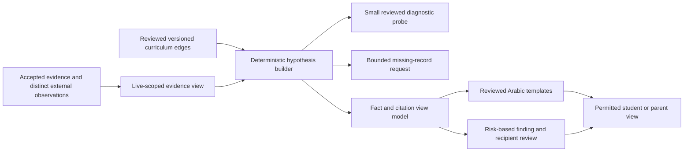

# Athar-derived product and architecture refinements

25 November 2026 · U28 / ATHAR-001 · inspected commit `a2e52a22fcc9e639a08c2e2040ac58479676ee24`. Founder asked to add useful architecture ideas after reviewing Athar. **Selected below as architecture refinements, not installed components or implementation permissions.** Existing Django/React/PostgreSQL, owned evidence authority, review gates and current phases remain. [Pinned evidence/limits](../research/athar-review/README.md) · [43-file source manifest](../research/athar-review/source-snapshot.json).

Priority means engineering sequencing within the named existing requirement, not a new founder deadline. Feature IDs below are subfeature locators, not replacements for R001–R105. Acceptance is future test design, not a claim of executed capability. F4 requires the ordinary F3 exit; teacher expansion remains future. AUTH-017's local mock is unaffected.

## Selected and deferred feature ledger

| ID / disposition | Useful feature and evidence | Requirements / priority / dependencies / placement | Sebaverse acceptance and boundaries |
|---|---|---|---|
| ATH-F01 · selected refinement | Cited prerequisite path and competing explanations; ATH-E01/E02. | R025/R026/R027/R028; high; reviewed graph edges, accepted evidence and scoped query; F4 learning loop. | Return permitted evidence references, edge versions, unknown observations, alternate paths and a small reviewed next probe. Unknown is not low ability. Use hypothesis language; no causal-root verdict, psychological label, inherited numeric confidence or mastery from raw marks. Cross-subject paths require reviewed mappings and do not transfer mastery. |
| ATH-F02 · selected refinement | Ask for missing evidence rather than fill a gap; ATH-E02. | R026/R038/R047/R050; medium; live purpose/relationship, versioned hypotheses and request lifecycle; F4, teacher UI later. | Request at most a configured bounded number of relevant records, deduplicate per unresolved concept/version and expire/cancel on scope change. “No record exists” is a valid answer. Do not infer absence of learning from absence of records, repeat prompts indefinitely or send messages automatically. New personal/audit fields require purpose, retention and deletion approval. |
| ATH-F03 · selected refinement | Deterministic Arabic fact-to-wording templates and view models; ATH-E02. | R013/R014/R047/R062/R069/R070; high; approved facts/citations and message catalog; F4 reports. | Routine summaries can render reviewed templates without a model call. Test numbers, negation, units, uncertainty, Arabic plural/terminology and accessible RTL. Optional model wording may rephrase eligible facts only; unsupported claims fail to a reviewed template. Measure fidelity and actual call/receipt savings before claiming economic benefit. A template does not validate its underlying inference. |
| ATH-F04 · selected refinement | Parent overview ordered around evidenced progress, one support priority and the next action; ATH-E03. | R024/R047/R056/R060; medium; live reporting consent, minimal scoped evidence and learning projections; F4 parent slice. | Each card has evidence/uncertainty and an actionable suggestion. Thin evidence produces an honest empty state. Never copy a fixed six-mark threshold, compare children, expose every record by default or display a raw score average as mastery. Recheck citation access and purpose on open/export. |
| ATH-F05 · selected future ingestion capability | Spreadsheet/marked-paper preview, correction and confirm; ATH-E04. | R025/R038/R041/R046/R050/R091/R092; medium; qualified ingestion, structured schemas, identity/scope and review; phased after F3, photo modality later. | Preserve source hash/row/page provenance, original mark/max, time and correction lineage. Validate identity, duplicate import, totals and units; preview is not saved evidence. Store as external observation with assistance/exposure/assessment conditions unknown unless independently established. Import or educator confirmation alone never promotes mastery. Photos/Office files need their own parser/rights/privacy review; no filename/name inference as authorization. |
| ATH-F06 · selected refinement of existing versioning | Reviewable topic/prerequisite overlays over an immutable curriculum; ATH-E05. | R027/R035/R036/R041/R042/R094; high for mapping design; exact edition/edge provenance and reviewer; DEV-011 when eligible. | Draft, validate, review and version both topic and relationship. Check cycles and distinguish prerequisite from illustrative/related links. Keep private overlays private; publishing/shared promotion has separate rights and authority. Withdraw access even when historical evidence uses an old edge; retain lineage and replay/correction, rather than prohibit privacy/safety withdrawal because records exist. No global overlay silently repins sessions. |
| ATH-F07 · selected future report workflow | Separate approval of a substantive finding from its recipient-facing wording; ATH-E02. | R047/R050/R053/R060/R067/R092; medium; live reviewer grants, immutable fact/report versions and authorized reporting; F4 uncertainty, teacher expansion later. | For uncertain/imported/high-impact findings or formal educator reports, a named authorized human decides the finding, then reviews the exact recipient/version. Changed facts or wording invalidate the relevant approval. Record the authorized decision and redacted audit receipt atomically; retries are idempotent and conflicting decisions require explicit revision. Approval never sends a message or grants broader access. This is risk-based: do not make a teacher gate a dependency for every ordinary student turn or routine valid practice. |
| ATH-F08 · covered; retain as acceptance detail | Retraction of wrong evidence and grounded explanation/export; ATH-E02/E07. | R025/R061/R092; existing P0/P1; correction lineage and purpose-limited export. | Use superseding events and projection replay, not silent edit/deletion of grade history. A teacher handover/print view uses the permitted evidence view, no raw transcript or permanent public file. Export/backup/deletion restores must respect tombstones and current access; do not copy filename-only deletion or same-disk backup assumptions. |
| ATH-F09 · future experiment only | Compare observations around a teaching approach; ATH-E01/E03. | R032/R050; low; sufficient independently valid observations and evaluation design; later analytics. | Label observed change and confounding differences in items, time, assistance and curriculum. No causal “this teaching method worked” claim from before/after averages. Do not import the upstream confidence, score cutoffs or mixed-concept baseline as validated policy. |
| ATH-F10 · future teacher presentation | Class readiness overview and portable handover; current overview source plus ATH-E09 future extensions. | R050/R060/R061; low; assigned class/course/term authority and privacy-safe cohort rules; teacher expansion. | Teacher sees only assigned course/learner/purpose scopes, not every subject/year of every class member. No public ranking or broad peer comparison. Suppress unsafe small-cohort aggregates and revalidate export recipients. Teacher self-described approaches may aid discovery, not automated suitability rankings or teacher matching from child-score patterns. Existing school product is not proof of SaaS tenancy. |
| ATH-F11 · future discovery, not adoption | School-data interoperability and richer longitudinal/district/voice ideas; ATH-E09. | R050/R062/R094; low; demonstrated integration need and separate standards/terms review; A7. | Treat OneRoster/CASE or voice/district proposals as unimplemented discovery items. Inspect exact standard version, identifiers, content/processor rights and minimum data before a mapping/adapter ADR. No new dependency, compliance claim or roadmap date from a vision document. |
| ATH-F12 · covered; no stack adoption | Local-first/offline option, school vs family surfaces, export and synthetic exploration. | R006/R047/R050/R061/R062/R094; existing scope/future delivery. | Separate UI jobs from server authority; do not turn an installation mode or pasted cloud key into a family identity. Keep owned adapters and explicit privacy/cost eligibility. No LangGraph/MCP/SQLite/NetworkX/MarkItDown foundation, bundled model or Windows distribution is selected by this review. |

## Architecture integration

Use existing module seams; do not introduce another agent framework or separate graph database.

- **Learning/assessment own the facts.** Accepted independent, assisted, exposed and ambiguous evidence remain distinct. Imported marks/notes are external observations; a low historical mean or model-read quote cannot write mastery. Concept/edge/evidence versions and policy version accompany each hypothesis. Query and citation access remain live-server-derived.
- **Curriculum owns reviewed relations and overlays.** Candidate model suggestions stay untrusted. Original content and links have separate provenance and review. Cross-subject edges are explicit, versioned and revocable; they confer no entitlement or mastery equivalence.
- **Reporting owns the recipient projection.** A typed view model selects only permitted fact/evidence references. Deterministic templates are the cheap baseline. A formal review is bound to exact fact and report revisions and recipient purpose; outbox sending remains separately authorized.
- **Operations own bounded requests and corrections.** A future missing-record request may need stable identity, scope, concept/edge version, evidence references, status, expiry and response lineage. These are design fields only; choose retention and minimum personal fields before persistence. Cancel stale work on withdrawal, edition changes or corrections.

No new domain table, endpoint, provider route or migration is implemented here. “Selected” means include these acceptance details when the owning existing task becomes eligible. It does not expand AUTH-017 or preflight AUTH-016.

## Explicit non-adoptions and evidence limits

Athar's root code license does not clear its packs, translations, source works, dependencies, models or provider processing. Per-edition Egypt mappings and author-created prerequisite edges need original evidence and educator review. The source is synthetic and selectively inspected; tests were read, not run. Local/family demo access, broad class history, raw document/model processing, model-written active evidence, lexical-only Arabic guards and incomplete backup/shared-file deletion are not approved patterns for Sebaverse.

The model cannot approve findings, grades, access or reports. Retaining a human review step does not prove that a claim is correct, that an imported mark was unaided, or that an inferred cause is valid. The concrete transferable value is the interaction and evidence contract, implemented later in Sebaverse's existing deterministic authority.
