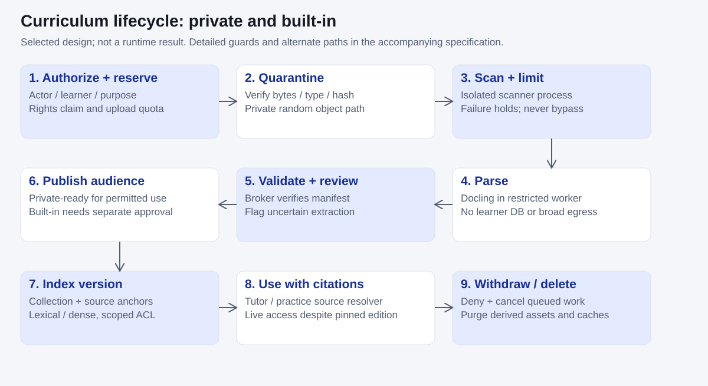
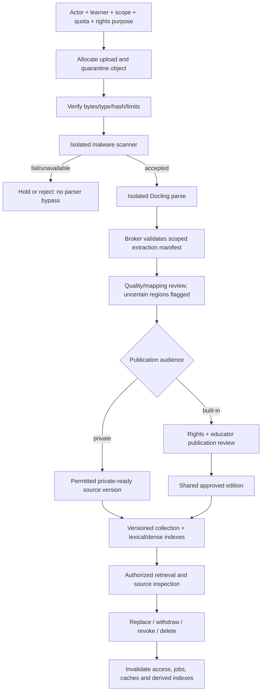
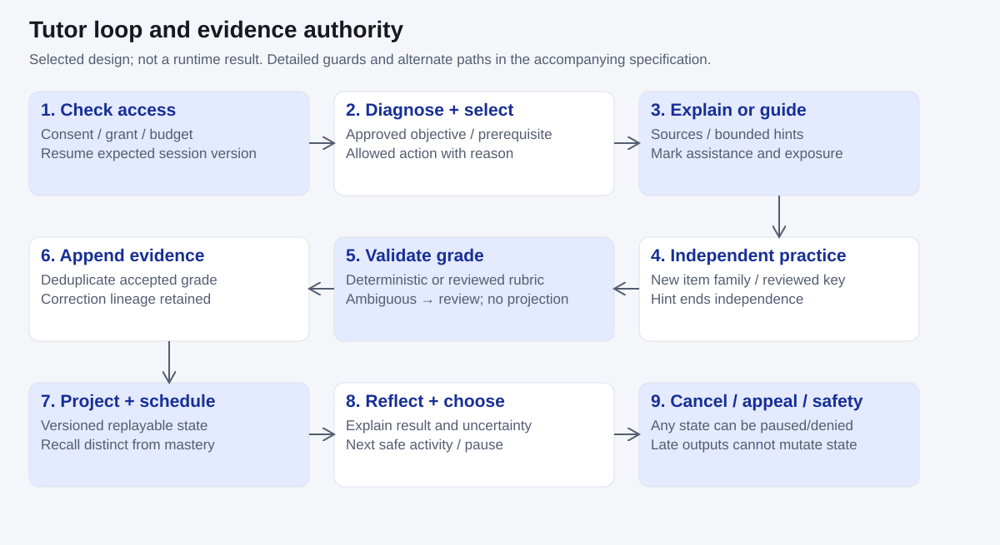
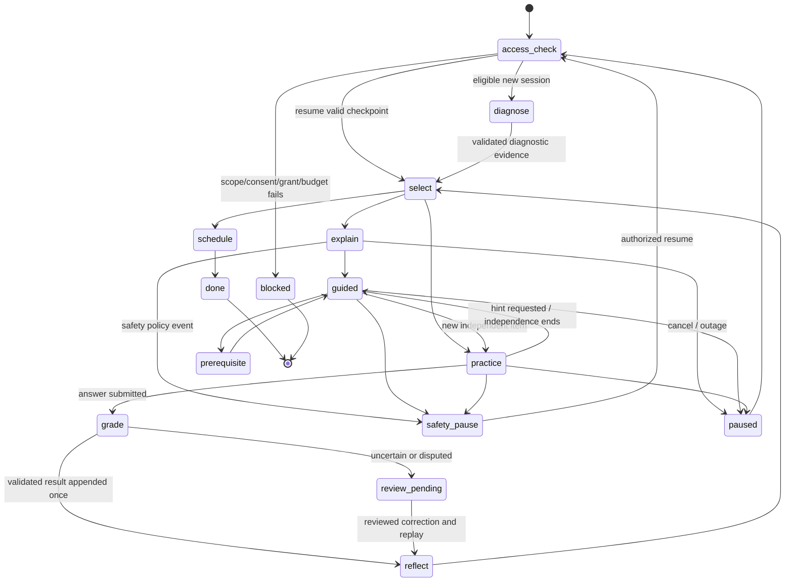
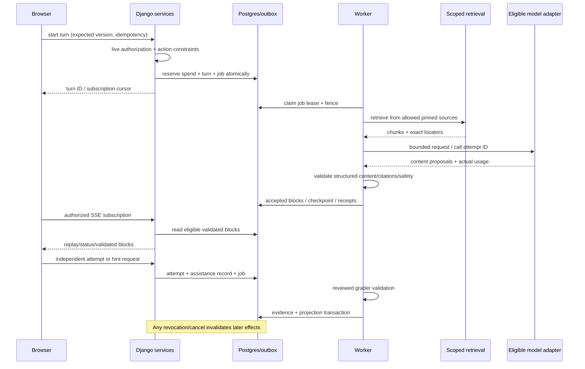
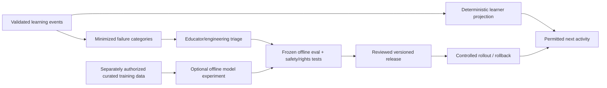

# Detailed runtime and lifecycle maps

U11/U12 · Selected design, not implementation. [System topology](technical-baseline.md) and [entity map](system-and-data-model.md) complement these editable Mermaid diagrams.

## Curriculum ingestion and publication

## Tutoring and assessment state machine

Any state can be cancelled/denied on live revocation; diagram omits repeated arrows for legibility. Cursor/version/cancellation generation fences reject late output. No autonomous model transition or write to learner projections.

## Request, model and evidence sequence

Browser command → Django authorization and atomic spend reservation → durable worker lease → scoped retrieval → eligible provider call → validated content blocks and usage receipts → authorized SSE replay. Independent answers enter the separate reviewed grading/evidence path. Cancellation or revocation fences all later effects.

## Release and controlled improvement

Validated evidence updates the learner projection and next permitted activity. Separately, minimized failure categories go through educator/engineering triage, frozen evaluation and reviewed versioned release with rollback. Optional model training uses separately authorized curated data and the same release gate, never automatic child-chat ingestion.

No raw identifiable child conversation automatically enters training or evaluation fixtures. A positive engagement signal is not evidence of mastery or efficacy.
