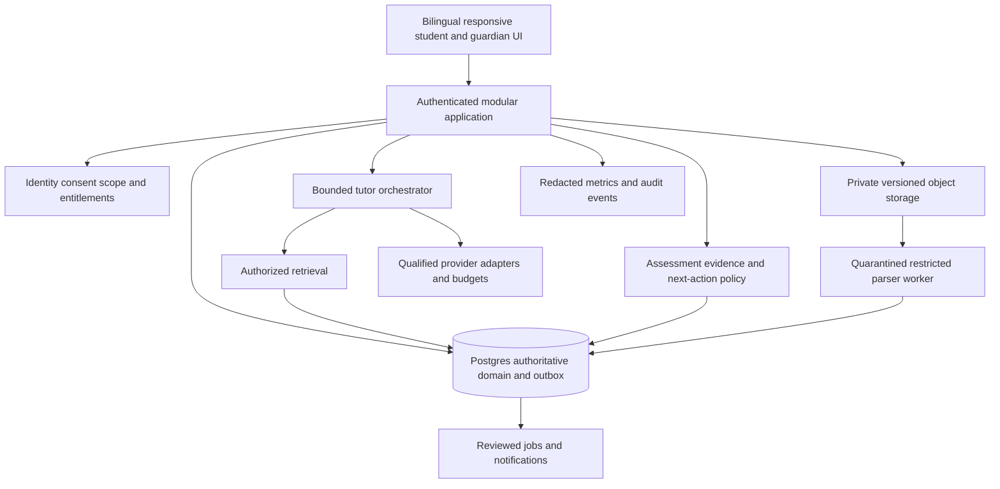

# Architecture and domain model

Status: proposed, awaiting G3. Sources A07/A12 and G04–G06; owned learning core is a research recommendation consistent with founder constraints. Framework/version selection remains open. Django/PostgreSQL is the baseline candidate; compare a thin FastAPI-based alternative on auth/admin/content review, security surface, async/voice fit, team familiarity and total operational work. Avoid selecting based on a synthetic hello-world benchmark.

## Deployment and boundaries

One deployable application with clear modules: identity/consent, curriculum/rights, assessment, learner intelligence, tutoring, retrieval, AI adapters, billing/usage, reporting and operations. Separate restricted parser environment and optional media worker for safety/runtime needs; they do not require general microservices. Postgres is transactional source of truth. Private assets use signed short-lived access after authorization. Add pgvector only if filtered recall/latency improves over lexical baseline. No graph DB initially; versioned edge tables suffice. A job/outbox worker begins in the same domain; add Celery/Redis when demonstrated scheduling/concurrency warrants it.

## Domain entities and invariants

| Aggregate / entity | Key fields and relations | Invariant |
|---|---|---|
| Tenant / User / Membership | id, role, status, locale | Role never taken from client assertions |
| LearnerProfile | user, minimal age band, preferences | Identifying contact separated from learning analytics |
| GuardianRelationship / Consent | adult, child, scope, verification, purpose/version, dates/revoked | Live relationship and legal process checked for every sensitive command |
| CurriculumEdition / Objective / ConceptMapping | system, body, year/specification, subject/term/language, immutable version | Mapping confidence/review; no silent equivalence |
| PrerequisiteEdge | concept versions, provenance, reviewer | Approved acyclic graph or explicit supported exception |
| MaterialVersion / RightsRecord | owner/scope/hash/license/original/source/version | Publication requires rights and content approval |
| Chunk / IndexManifest | source/page/bbox/objectives/ACL/parser/embedding | Retrieval cannot widen material scope |
| ItemFamily / ItemVersion / Rubric | objective, solution ref, exposure, language, approval | Reviewed key separated from tutor-visible practice context |
| Attempt / AssessmentEvent | learner/session/item version, response ref, score, assistance, timestamps | Idempotent immutable evidence with correction lineage |
| KnowledgeProjection / MisconceptionHypothesis | concept version, evidence cursor, status/uncertainty | Rebuildable; no LLM direct write authority |
| ReviewSchedule / ReviewEvent | learner/concept/item family, due/result | Recall scheduling distinct from mastery |
| TutorSession / Turn / Summary | state/checkpoint/request, release manifest, bounded memory | Turn-scoped cancellation and authorized tools |
| Enrollment / Entitlement | learner/course/term, quotas, start/end, grant source | Expiry/revocation enforced at command/tool boundary |
| PaymentEvent / UsageReservation / UsageReceipt | idempotency/provider ID, units, rate version, amount/currency | Never count payment webhook twice; reconcile reservations |
| Notification / Incident / Appeal | verified recipient/purpose/status, minimal payload | No external send without authorized workflow |
| ReleaseManifest / AuditEvent / Outbox | hashes/versions, actor/event, schema, processed state | Durable lineage and reviewed replay |

All learner-owned domain records carry canonical tenant/learner scope, created/occurred/received times and schema version where relevant. Unique command/event/provider receipt keys prevent double writes. Constraints validate scope consistency across joins. Raw SQL/vector and file access use the same authorization policy as ORM commands; optional RLS is defense in depth and must reset pooled connection context correctly.

## Transaction and API contracts

Conceptual authenticated commands: start_tutor_turn, cancel_turn, submit_assessment, get_progress, request_upload, publish_curriculum_version (staff), create_guardian_link, revoke_consent, grant_course, request_export and delete_learner_data. Browser cannot submit trusted score/mastery/consent status. Use request idempotency key and expected session/item/version; return correlation ID, state, result or safe recoverable error.

submit_assessment validates role/grant/item independence → records attempt and outbox atomically → grades under bounded process → appends validated result → idempotent projection update. Queue delivery may be at-least-once; domain effects are once per event. Out-of-order events use defined event-time ordering plus tie-breaker and replay/conflict handling, never silent arrival-order mutation. Correction events supersede evidence without erasing audit history, subject to approved deletion/minimization policy.

Tutor command atomically reserves maximum spend → resolves approved evidence/action → calls qualified provider → validates result/citations → reconciles actual receipt and releases remainder → stores bounded checkpoint. Orphan reservations expire/reconcile; vendor billing can outlive app cancellation. Payment webhook uses signature, exact route, replay window and unique provider event; reversals/expiry change entitlements predictably. No browser-supplied paid flag.

## Failure and exit design

Provider outage: circuit breaker and qualified fallback or resumable pause. Parser crash: bounded retry/quarantine. Invalid item: quarantine, notify reviewer and replay affected state. Budget cap: safe quota explanation, no hidden upgrade. Revoked guardian: immediate denial plus queued job cancellation. Export contains curriculum/item/source versions, allowed original assets, consent/grants and learning evidence, not opaque chat summaries alone.

Migrations use expand/contract and versioned projection rebuild; backfill asynchronously with checks. Preserve source chunks for reindexing and provider-independent prompts/evals. Deployment region, tenancy beyond families, payment provider, frontend framework and realtime transport remain open ADRs. No production topology or uptime promise is inferred from the diagram.
