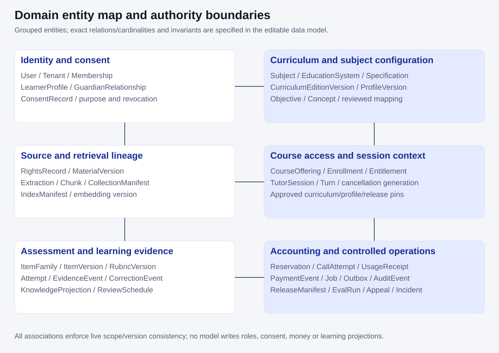
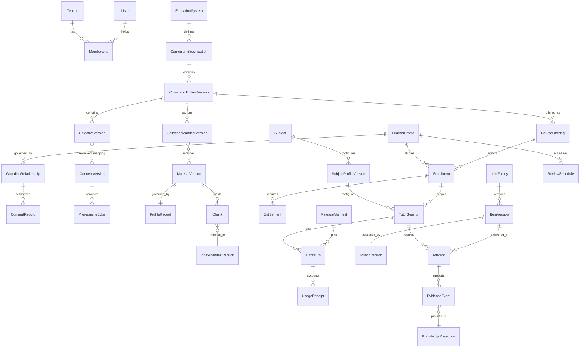

# Architecture and domain/data model — v1.0

Selected technical design under U11/U12. [Technical baseline](technical-baseline.md) supersedes the earlier framework comparison. Django/DRF + React/TypeScript/Vite + PostgreSQL + private object storage; subject-independent modular core with isolated parsing. No product schema/migration executed. Prior proposal remains in Git history.

## Conceptual entity map

The diagram is conceptual, not a claim all relationships are 1:1 physical tables; rights and rubric can be separately versioned/reused. KnowledgeProjection is derived from many events and one event may affect several concept projections; an explicit projection-input link/cursor captures this mapping rather than a restrictive physical foreign key. Curriculum IDs remain nullable for genuinely custom materials, never falsely official. Shared approved content has publication audience records; learner-private content always retains its actual ownership scope.

## Aggregates and invariants

| Aggregate | Minimum fields / constraints |
|---|---|
| User / Tenant / Membership | Immutable ID, status, verified auth relations, locale; tenant role from server, never client or model |
| LearnerProfile | Actor distinct from learner; minimal age band and volunteered preferences; no inferred disability or permanent intelligence label |
| GuardianRelationship / ConsentRecord | Verified adult-child link, purpose/scope, policy version, recorded/revoked times, evidence reference; live checks for sensitive access |
| EducationSystem / Subject / Specification | Country/authority/qualification tags and identifiers; no fixed Egyptian/German enum in core |
| CurriculumEditionVersion / SubjectProfileVersion | Immutable version, status, provenance/reviewer, locale/capability schema; withdrawal overrides pinned session availability |
| ObjectiveVersion / ConceptVersion / Mapping / Edge | Many-to-many mapping, confidence/reviewer, edition and edge provenance; approved graph validation; no silent mastery equivalence |
| CollectionManifestVersion | Explicit source versions + audience; pinned session collection, not all uploads in account |
| MaterialVersion / RightsRecord | Original hash, owner, processing/display/derivative/distribution/training permissions, restrictions/expiry, source and reviewer; private is not public approval |
| ExtractionManifest / Chunk / IndexManifestVersion | Parser/model version, original + normalized text, page/bbox, quality, audience/ACL, embedding model/dimension/hash; no mixed embedding spaces |
| ItemFamily / ItemVersion / RubricVersion | Objectives, source, review state, answer key scope, valid variants, grader/profile version, exposure rules; keys excluded from tutor retrieval |
| Attempt / EvidenceEvent / CorrectionEvent | Learner/item/session IDs, occurrence/receipt times, response reference, assistance/exposure, grader/rubric, accepted score or pending status; unique event and command IDs |
| KnowledgeProjection / MisconceptionHypothesis | Learner/concept-version, evidence cursor, state/uncertainty, independent-family counts, contradictions and expiry; rebuildable, no LLM direct writes |
| ReviewSchedule / ReviewEvent | Due time, strategy/algorithm version, accepted recall result; independent of mastery projection |
| Session / Turn / StreamCheckpoint | Curriculum/profile/item/release versions, state/version, cancellation generation, bounded summary; validated block cursor, no hidden chain-of-thought storage |
| Enrollment / Entitlement | Learner/course/status + grant purpose, start/end, quotas; payment alone does not prove valid consent |
| UsageReservation / CallAttempt / UsageReceipt | Maximum reserve, provider attempt/request ID, actual input/output/cache/audio units, price version/currency, unknown/reconciled state; original units retained |
| PaymentEvent / Notification / Preference | Signed deduplicated payment event; recipient/purpose/channel opt-out; real external effects gated |
| Job / Outbox / AuditEvent | Schema version, scope generation, idempotency, lease/fence, status/retry/deadline; restricted payload/reference |
| ReleaseManifest / EvaluationRun / Incident / Appeal | Immutable lineage, fixture/rubric/model/policy versions, result/reviewer; raw child payload excluded from default evals/logs |

Foreign keys and unique/composite constraints enforce learner/course/edition consistency, not prompt instructions. Actor-owned sensitive records carry tenant/learner scope; global approved content uses explicit publication grants instead of fabricated learner ownership. Money uses integer minor units/decimal rates with currency, never binary floats; usage units remain exact integer/decimal by modality. Time stored UTC with occurrence and receipt separately; UI localizes. Sort replay deterministically by accepted sequence and event-time rules with tie-breaker; corrections append lineage before rebuilding, subject to privacy deletion requirements.

## Privacy, lifecycle and contracts

Contact/auth records, learning evidence, restricted safety/consent audit and routine operations telemetry have distinct access/retention purposes. Transcript/audio retention is not required for mastery projection; use minimal response/evidence references and authorized deletion. Export includes allowed source and curriculum/item/policy versions. Revocation blocks live access and cancels queued work before asynchronous deletion; backups restore deletion tombstones before access.

[API/event contracts](api-and-event-contracts.md) define idempotency, stale workers, cancellation and provider billing uncertainty. [Subject contracts](subject-and-curriculum-contracts.md) define adding subjects without core changes. [Deployment](deployment-and-delivery.md) defines roles/keys and migration rules. Database migrations are future code tasks and must test both schema constraints and application authorization.
