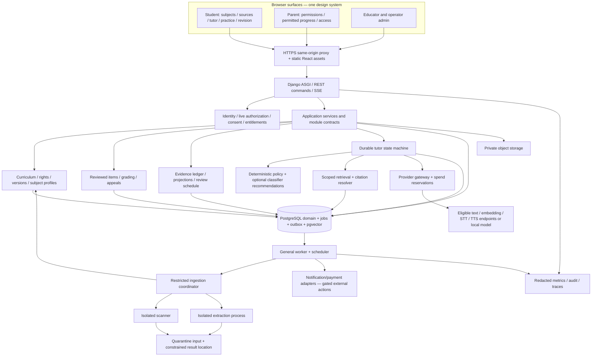

# Sebaverse technical architecture baseline — v1.0

11 November 2026 · sources U1/U2/U11/U12; A01–A13 and G04–G10 remain dated research. **Status: technical design selected under the founder's instruction to finalize architecture.** Author: project engineering agent. This is a concrete design baseline for audit, not a claim of founder sign-off on unseen details, passed benchmarks, legal clearance or implementation permission. Architecture choices below replace the earlier open stack comparison. Production and PoC execution gates remain separately recorded.

## 1. Decision summary

| Layer | Selected baseline | Boundary / consequence |
|---|---|---|
| Product core | Owned modular monolith, one repository | One business authority; no whole upstream tutoring/LMS foundation |
| Backend | Python 3.12 + Django 5.2 LTS + Django REST framework | Django auth/admin/ORM/migrations; synchronous transactional services; ASGI endpoints for event streaming |
| Web product | React + TypeScript + Vite, React Router and TanStack Query | Static build, same-origin API, reusable Arabic-first components using current design tokens; no separate Node production server |
| Persistence | PostgreSQL 17, JSONB for validated profile/config extensions | Relational scope/version/financial invariants; JSONB is not an untyped replacement for domain tables |
| Retrieval | PostgreSQL lexical retrieval + pgvector dense path, bounded reciprocal-rank fusion | Lexical baseline always measured; exact filtered vector search first, ANN only after filtered recall tests |
| Assets | Private S3-compatible object storage | Separate quarantine/accepted/derived access; short-lived access issued only after authorization |
| Ingestion | Isolated extraction worker; direct PyPDFium2 for first authored text-only PoC (AUTH-013/ADR-014), Docling advanced extraction retained; isolated malware scanner boundary | No learner DB credentials or arbitrary network access; signed scoped job manifests; PaddleOCR only if evaluated need |
| Tutoring | Owned finite-state orchestration, typed tools, approved subject profiles | Models propose content; application owns transitions, authorization, score acceptance and projections |
| Jobs | PostgreSQL durable job/outbox tables + same-codebase workers | At-least-once execution, leases/heartbeats/idempotent effects; no broker or Celery initially |
| Text transport | REST commands + server-sent events (SSE) over ASGI | Durable turn IDs, replay, cancel endpoint, server-authorized subscriptions; no WebSockets required for text |
| Voice | Push-to-talk STT → text tutor → TTS, adapter-based | Text always available; realtime voice has a separate benchmarked adapter seam, not initial default |
| Models | Direct provider adapters behind owned capability/eligibility registry | Default + qualified fallback selected by evaluation/terms; OpenAI/Claude/Gemini/Chinese/open-weight/local remain supported adapter families |
| Recall | Fixed schedule baseline; py-fsrs adapter comparator | FSRS is a selected reuse component for recall experiments, never an educational mastery estimator |
| Evaluation / telemetry | Own fixtures + pytest/Playwright + Promptfoo offline + OpenTelemetry | Metadata-only observability defaults; no raw child prompts/audio in routine telemetry |
| Packaging / delivery | OCI containers; Docker Compose local; same-origin reverse proxy; GitHub Actions workflow design | Actual remote, accounts, region and production provisioning require separate authorization |

Exact package patches, toolchain minors, image digests and dependency closure are resolved and recorded before installation. This is release pinning, not a reopening of selected architecture. Python/Django compatibility, parser model rights and resolved vulnerabilities must pass then. Do not install latest tags or use research commit SHAs as an untested production lock. The Vite build has no runtime Node requirement; choose a compatible supported Node LTS for builds when locking.

React adds a typed UI toolchain compared with the old template-first proposal, justified by multi-panel tutoring, citations, editable transcripts, source review and reusable parent/student components. Keeping all business authority in Django and serving static assets on the same origin avoids a second backend. No Next.js server or React Server Components at baseline; public marketing can be static. DRF handles ordinary HTTP APIs; native Django ASGI views handle streaming, not an assumption that all DRF views are async.

## 2. System map

Parser arrows indicate constrained job I/O, not a database write permission. Ingestion coordinator validates result manifest, checks current permission/generation/version and commits metadata; parser output is untrusted. External model arrows are gated egress, not permission to send child data to every provider. Web and workers share domain code, not unrestricted credentials.

## 3. Module ownership

| Module | Functions | Owns / refuses |
|---|---|---|
| identity | login/logout, staff MFA, account recovery, actor/learner separation | Uses established auth; roles never model/client assertions |
| access | relationship verification, consent, course grants, object scope, revocation | Single server-derived policy used by API, retrieval, files, jobs and tools |
| curriculum | systems/subjects/editions, private materials, rights, mappings, publication | No private upload automatically promoted to shared course |
| ingestion | quotas, upload sessions, scanner/parser jobs, extraction review | No unsafe parsing in API process; unknown quality remains flagged |
| assessment | item families, keys/rubrics, attempts, graders, adjudication | Versioned score proposals; validated evidence only |
| learning | evidence, misconception hypotheses, projections, prerequisites, due review | No narrative memory or classifier confidence treated as mastery |
| tutoring | state machine, bounded action selection, tool dispatch, summaries | No arbitrary agent code/tools or model-directed authorization |
| retrieval | chunk/index lifecycle, scoped query, fusion, citations | No global unscoped search followed only by postfilter |
| providers | capability registry, adapter normalization, privacy eligibility, cancellation | No vendor type leaks into business data; no ineligible cheap fallback |
| usage/commerce | quotas, reserve/finalize/reconcile, grants, webhook events/refunds | No card storage; access separate from money collection |
| reporting | learner/parent views, educator review, later classroom projections | Aggregates authorized evidence, not invented attainment percentages |
| operations | outbox/jobs, release manifests, evaluations, incidents, audit/export/deletion | No raw child data in routine logs or automatic training |

Modules expose typed application services and versioned events. Cross-module writes go through owning service; no model or frontend can directly mutate DB tables. Tests enforce import boundaries. Repository layout at implementation: backend/config, backend/modules/{module}, web/src/{app,features,ui}, workers/parser, contracts, evals, infra, with existing docs/research preserved. This is a planned layout, not a generated application.

## 4. Subject-independent extension

A SubjectProfileVersion identifies reviewed teaching strategies, allowed representations/tools, grader types and retrieval settings. CurriculumEditionVersion supplies the syllabus, objectives and sources. A learner can enroll in any number of courses with distinct editions. Language of instruction, UI locale and target language are independent fields. No core branch such as `if subject == German` is permitted.

Adding a normal subject means content/configuration and reviewer work, using existing item/representation/grader capabilities. A genuinely new modality or grading method requires a reviewed adapter implementation; do not claim every subject can be added with zero engineering. See [contracts](subject-and-curriculum-contracts.md). Built-in and privately uploaded content use the same version/provenance pipeline with different ownership/publication rules.

## 5. Main runtime flows

**Upload:** resolve scope/rights/quota → allocate upload → stream to quarantine → verify bytes/type/checksum → scan/resource checks → isolated parse → validate manifest → review extraction/mapping → publish private-ready or separately approved built-in version → index. Failed/stale jobs cannot publish. Rights withdrawal, deletion and revocation invalidate derived access as well as originals.

**Tutor:** authorize actor/learner/course/consent → reserve allowed spend → atomically start turn/checkpoint → pick deterministic permitted action → retrieve from pinned authorized sources → call eligible model with bounded context/tools → validate structured output/citations/safety → emit validated blocks → reconcile receipts → checkpoint. SSE status may stream early; generated text is buffered until that block's checks pass. Do not send unverified text to a child merely for first-token latency. Worker crashes can pause a turn safely; paid provider calls are not assumed exactly-once.

**Assessment:** lock expected item/session state → record attempt and assistance/exposure → grade with reviewed rubric/tool → ambiguous result pending review → append accepted grade event → versioned projection update → next permitted action. Answer keys stay out of learner-facing retrieval; request retries never double score.

**Parent/report:** live verified relationship + purpose scope → permitted evidence summary and uncertainty → minimal suggested support. Raw transcripts are not a default entitlement. Teacher/organization authority is separate from guardian authority.

**Provider route:** legal/privacy/content eligibility → capability → per-task quality/safety → availability → budget. Classifier may rank already-allowed options; cannot broaden scope or write business state. All requests record release/curriculum/prompt/model/index/policy versions and actual usage units. Prompt/context caching is eligibility-scoped; private learners do not share personalized caches.

## 6. Operating shape and expansion

Start with web, general worker/scheduler, parser/scanner isolation, PostgreSQL and object storage. Process boundaries protect runtime and credentials; they are not a microservices program. No initial Redis, Kubernetes, Kafka, separate vector database, graph database, LangChain/LlamaIndex framework or self-hosted GPU requirement. Scale API/worker replicas and indexed queries first. Consider a dedicated broker only after job/DB contention; vector service only after filtered recall/latency demands it; realtime media service only after cost/quality/privacy tests; local inference only after quality and utilization evidence.

Hosting region/provider, payment gateway, exact model endpoints, retention durations and legal consent process remain owning decisions. Their interfaces are fixed here; their eligibility cannot be invented. None requires a specific school textbook to settle architecture.

## 7. Audit package map

- [Subject/curriculum contracts](subject-and-curriculum-contracts.md)
- [Data model](system-and-data-model.md)
- [API/events and failure semantics](api-and-event-contracts.md)
- [Repository adoption and exclusions](repository-adoption.md)
- [Deployment/security/CI](deployment-and-delivery.md)
- [Full feature/function coverage](feature-function-matrix.md)
- [PoC phases and acceptance](../execution/subject-independent-poc.md)
- [Architecture source checks](../sources/architecture-primary-checks.md)

No performance, safety, efficacy or cost benchmark result is claimed in this baseline.

AUTH-013 / ADR-014, 19 November: founder selected the direct same-engine adapter for the initial authored text-only PDF PoC. This reduces the proposed Python package closure but grants no native/scanner/runtime/phase clearance. Advanced OCR/layout, all R039 capabilities and independent fidelity evaluation remain required; the direct PoC does not pass F3.
