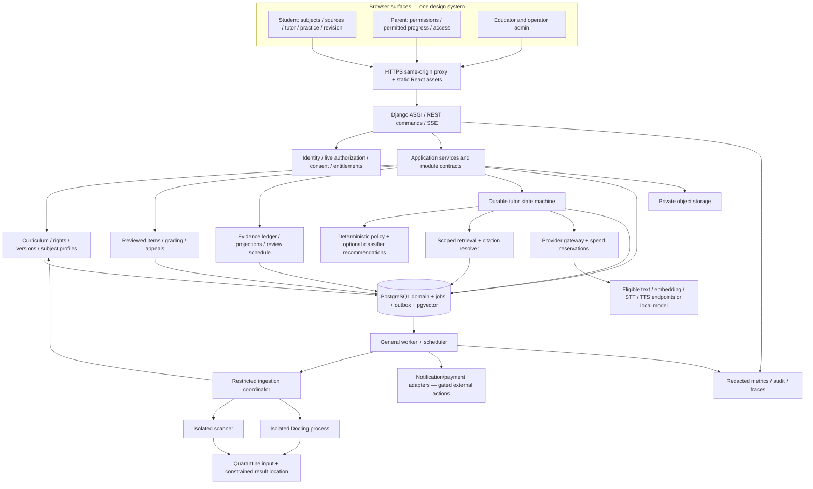
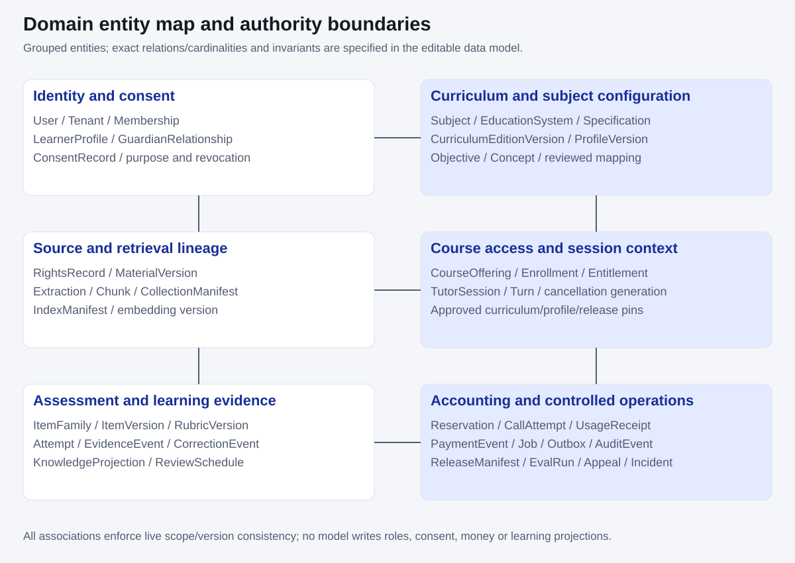
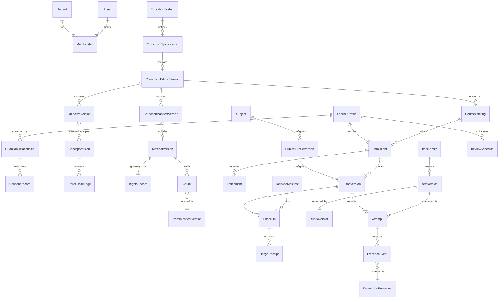
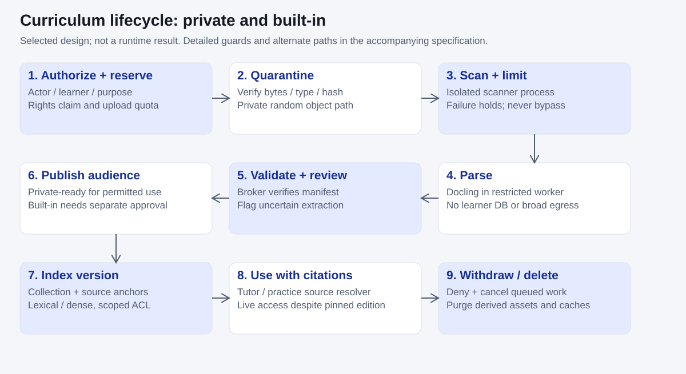
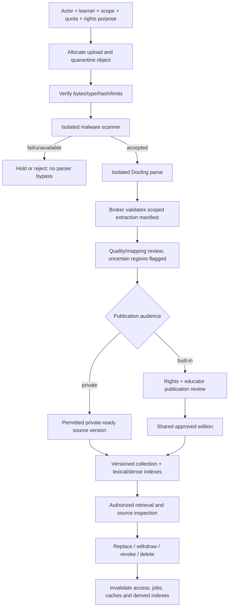
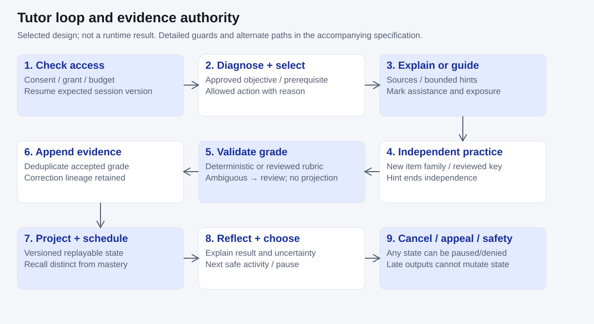
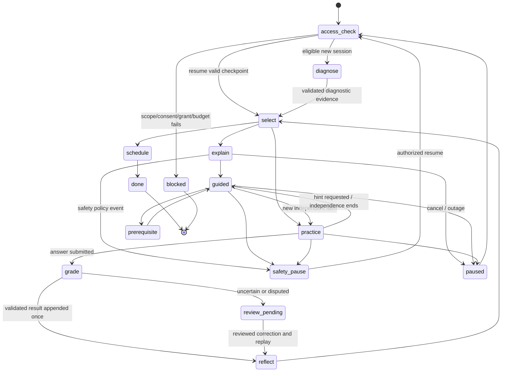
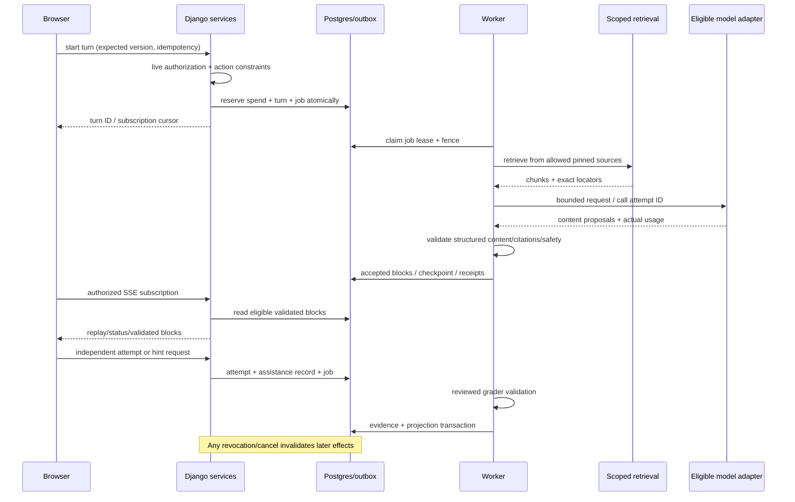
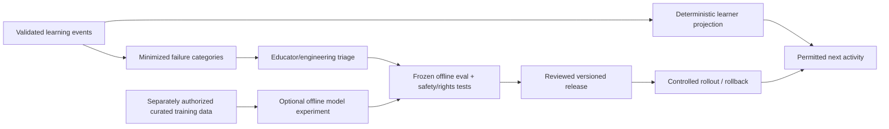

# Sebaverse — architecture audit book v1.0

11 November 2026. Selected technical design under U11/U12. No product implemented or benchmarks run. All 99 requirements and 22 audited repo dispositions accounted for. Original research and complete machine-readable registers are bundled alongside this book.

---

# Sebaverse technical architecture baseline — v1.0

11 November 2026 · sources U1/U2/U11/U12; A01–A13 and G04–G10 remain dated research. **Status: technical design selected under the founder's instruction to finalize architecture.** Author: project engineering agent. This is a concrete design baseline for audit, not a claim of founder sign-off on unseen details, passed benchmarks, legal clearance or implementation permission. Architecture choices below replace the earlier open stack comparison. Production and PoC execution gates remain separately recorded.

## 1. Decision summary

| Layer | Selected baseline | Boundary / consequence |
|---|---|---|
| Product core | Owned modular monolith, one repository | One business authority; no whole upstream tutoring/LMS foundation |
| Backend | Python 3.12 + Django 5.2 LTS + Django REST framework | Django auth/admin/ORM/migrations; synchronous transactional services; ASGI endpoints for event streaming |
| Web product | React + TypeScript + Vite, React Router and TanStack Query | Static build, same-origin API, reusable Arabic-first components using current design tokens; no separate Node production server |
| Persistence | PostgreSQL 17, JSONB for validated profile/config extensions | Relational scope/version/financial invariants; JSONB is not an untyped replacement for domain tables |
| Retrieval | PostgreSQL lexical retrieval + pgvector dense path, bounded reciprocal-rank fusion | Lexical baseline always measured; exact filtered vector search first, ANN only after filtered recall tests |
| Assets | Private S3-compatible object storage | Separate quarantine/accepted/derived access; short-lived access issued only after authorization |
| Ingestion | Isolated Docling parser worker; isolated malware scanner boundary | No learner DB credentials or arbitrary network access; signed scoped job manifests; PaddleOCR only if evaluated need |
| Tutoring | Owned finite-state orchestration, typed tools, approved subject profiles | Models propose content; application owns transitions, authorization, score acceptance and projections |
| Jobs | PostgreSQL durable job/outbox tables + same-codebase workers | At-least-once execution, leases/heartbeats/idempotent effects; no broker or Celery initially |
| Text transport | REST commands + server-sent events (SSE) over ASGI | Durable turn IDs, replay, cancel endpoint, server-authorized subscriptions; no WebSockets required for text |
| Voice | Push-to-talk STT → text tutor → TTS, adapter-based | Text always available; realtime voice has a separate benchmarked adapter seam, not initial default |
| Models | Direct provider adapters behind owned capability/eligibility registry | Default + qualified fallback selected by evaluation/terms; OpenAI/Claude/Gemini/Chinese/open-weight/local remain supported adapter families |
| Recall | Fixed schedule baseline; py-fsrs adapter comparator | FSRS is a selected reuse component for recall experiments, never an educational mastery estimator |
| Evaluation / telemetry | Own fixtures + pytest/Playwright + Promptfoo offline + OpenTelemetry | Metadata-only observability defaults; no raw child prompts/audio in routine telemetry |
| Packaging / delivery | OCI containers; Docker Compose local; same-origin reverse proxy; GitHub Actions workflow design | Actual remote, accounts, region and production provisioning require separate authorization |

Exact package patches, toolchain minors, image digests and dependency closure are resolved and recorded before installation. This is release pinning, not a reopening of selected architecture. Python/Django compatibility, parser model rights and resolved vulnerabilities must pass then. Do not install latest tags or use research commit SHAs as an untested production lock. The Vite build has no runtime Node requirement; choose a compatible supported Node LTS for builds when locking.

React adds a typed UI toolchain compared with the old template-first proposal, justified by multi-panel tutoring, citations, editable transcripts, source review and reusable parent/student components. Keeping all business authority in Django and serving static assets on the same origin avoids a second backend. No Next.js server or React Server Components at baseline; public marketing can be static. DRF handles ordinary HTTP APIs; native Django ASGI views handle streaming, not an assumption that all DRF views are async.

## 2. System map

Parser arrows indicate constrained job I/O, not a database write permission. Ingestion coordinator validates result manifest, checks current permission/generation/version and commits metadata; parser output is untrusted. External model arrows are gated egress, not permission to send child data to every provider. Web and workers share domain code, not unrestricted credentials.

## 3. Module ownership

| Module | Functions | Owns / refuses |
|---|---|---|
| identity | login/logout, staff MFA, account recovery, actor/learner separation | Uses established auth; roles never model/client assertions |
| access | relationship verification, consent, course grants, object scope, revocation | Single server-derived policy used by API, retrieval, files, jobs and tools |
| curriculum | systems/subjects/editions, private materials, rights, mappings, publication | No private upload automatically promoted to shared course |
| ingestion | quotas, upload sessions, scanner/parser jobs, extraction review | No unsafe parsing in API process; unknown quality remains flagged |
| assessment | item families, keys/rubrics, attempts, graders, adjudication | Versioned score proposals; validated evidence only |
| learning | evidence, misconception hypotheses, projections, prerequisites, due review | No narrative memory or classifier confidence treated as mastery |
| tutoring | state machine, bounded action selection, tool dispatch, summaries | No arbitrary agent code/tools or model-directed authorization |
| retrieval | chunk/index lifecycle, scoped query, fusion, citations | No global unscoped search followed only by postfilter |
| providers | capability registry, adapter normalization, privacy eligibility, cancellation | No vendor type leaks into business data; no ineligible cheap fallback |
| usage/commerce | quotas, reserve/finalize/reconcile, grants, webhook events/refunds | No card storage; access separate from money collection |
| reporting | learner/parent views, educator review, later classroom projections | Aggregates authorized evidence, not invented attainment percentages |
| operations | outbox/jobs, release manifests, evaluations, incidents, audit/export/deletion | No raw child data in routine logs or automatic training |

Modules expose typed application services and versioned events. Cross-module writes go through owning service; no model or frontend can directly mutate DB tables. Tests enforce import boundaries. Repository layout at implementation: backend/config, backend/modules/{module}, web/src/{app,features,ui}, workers/parser, contracts, evals, infra, with existing docs/research preserved. This is a planned layout, not a generated application.

## 4. Subject-independent extension

A SubjectProfileVersion identifies reviewed teaching strategies, allowed representations/tools, grader types and retrieval settings. CurriculumEditionVersion supplies the syllabus, objectives and sources. A learner can enroll in any number of courses with distinct editions. Language of instruction, UI locale and target language are independent fields. No core branch such as `if subject == German` is permitted.

Adding a normal subject means content/configuration and reviewer work, using existing item/representation/grader capabilities. A genuinely new modality or grading method requires a reviewed adapter implementation; do not claim every subject can be added with zero engineering. See [contracts](architecture/subject-and-curriculum-contracts.md). Built-in and privately uploaded content use the same version/provenance pipeline with different ownership/publication rules.

## 5. Main runtime flows

**Upload:** resolve scope/rights/quota → allocate upload → stream to quarantine → verify bytes/type/checksum → scan/resource checks → isolated parse → validate manifest → review extraction/mapping → publish private-ready or separately approved built-in version → index. Failed/stale jobs cannot publish. Rights withdrawal, deletion and revocation invalidate derived access as well as originals.

**Tutor:** authorize actor/learner/course/consent → reserve allowed spend → atomically start turn/checkpoint → pick deterministic permitted action → retrieve from pinned authorized sources → call eligible model with bounded context/tools → validate structured output/citations/safety → emit validated blocks → reconcile receipts → checkpoint. SSE status may stream early; generated text is buffered until that block's checks pass. Do not send unverified text to a child merely for first-token latency. Worker crashes can pause a turn safely; paid provider calls are not assumed exactly-once.

**Assessment:** lock expected item/session state → record attempt and assistance/exposure → grade with reviewed rubric/tool → ambiguous result pending review → append accepted grade event → versioned projection update → next permitted action. Answer keys stay out of learner-facing retrieval; request retries never double score.

**Parent/report:** live verified relationship + purpose scope → permitted evidence summary and uncertainty → minimal suggested support. Raw transcripts are not a default entitlement. Teacher/organization authority is separate from guardian authority.

**Provider route:** legal/privacy/content eligibility → capability → per-task quality/safety → availability → budget. Classifier may rank already-allowed options; cannot broaden scope or write business state. All requests record release/curriculum/prompt/model/index/policy versions and actual usage units. Prompt/context caching is eligibility-scoped; private learners do not share personalized caches.

## 6. Operating shape and expansion

Start with web, general worker/scheduler, parser/scanner isolation, PostgreSQL and object storage. Process boundaries protect runtime and credentials; they are not a microservices program. No initial Redis, Kubernetes, Kafka, separate vector database, graph database, LangChain/LlamaIndex framework or self-hosted GPU requirement. Scale API/worker replicas and indexed queries first. Consider a dedicated broker only after job/DB contention; vector service only after filtered recall/latency demands it; realtime media service only after cost/quality/privacy tests; local inference only after quality and utilization evidence.

Hosting region/provider, payment gateway, exact model endpoints, retention durations and legal consent process remain owning decisions. Their interfaces are fixed here; their eligibility cannot be invented. None requires a specific school textbook to settle architecture.

## 7. Audit package map

- [Subject/curriculum contracts](architecture/subject-and-curriculum-contracts.md)
- [Data model](architecture/system-and-data-model.md)
- [API/events and failure semantics](architecture/api-and-event-contracts.md)
- [Repository adoption and exclusions](architecture/repository-adoption.md)
- [Deployment/security/CI](architecture/deployment-and-delivery.md)
- [Full feature/function coverage](architecture/feature-function-matrix.md)
- [PoC phases and acceptance](execution/subject-independent-poc.md)
- [Architecture source checks](sources/architecture-primary-checks.md)

No performance, safety, efficacy or cost benchmark result is claimed in this baseline.

---

# Subject and curriculum extension contracts

Selected technical design v1 · U11/U12 · R017–R045, R075, R094, R099. Content and assessment approval remains distinct from software configuration.

## Domain separation

EducationSystem → CurriculumSpecification → CurriculumEditionVersion → CourseOffering → Enrollment. Subject is an independent taxonomy, not a deployment. Custom/private courses may leave official specification null; they must not claim ministry alignment. An AcademicPeriod is metadata, not a hard-coded Egyptian semester enum. ObjectiveVersion maps to ConceptVersion through reviewed MappingVersion; equivalence across courses or subjects is explicit, never inferred mastery transfer.

SubjectProfileVersion specifies instruction language options, target language when relevant, representation capabilities, permitted action templates, grader configurations, prerequisite conventions and retrieval normalization. Values are schema-validated IDs from a reviewed registry, not Python paths, uploaded plugins or executable prompt instructions. Policy limits and safety rules are global constraints a profile cannot weaken. Copying a profile creates a new version; active sessions pin the old one until an explicit migration or withdrawal.

## Profile fields

| Field | Meaning / constraint |
|---|---|
| id/version/status/reviewer | Immutable published profile; draft/approved/withdrawn lifecycle |
| subject taxonomy | Language, mathematics, science etc. are tags, not conditionals in core |
| instruction_locales/target_language | Egyptian Arabic/MSA/English explanation independent of curriculum language |
| representations | text, bilingual span, equation AST, table, image region, later interactive manipulative |
| graders | reviewed exact-set, typed numeric, structured choice, rubric proposal with adjudication; optional restricted symbolic/language adapter |
| teaching strategies | diagnostic, explain, worked example, guided step, independent practice, delayed retrieval |
| evidence policy version | Independent/assisted/exposed/ambiguous semantics; profile thresholds remain educator-reviewed hypotheses |
| retrieval configuration | lexical normalization/embedding/rerank settings; may not broaden ACL or combine incompatible embedding spaces |
| allowed tools | Registry identifiers authorized independently by runtime; no generic shell/browser/code executor |
| accessibility | alternative representation and speech/text controls; never an inferred disability classification |

## Adding content or a subject

1. Create or choose a reviewed subject profile and permitted grader types.
2. Register source ownership, processing/display/derivative rights and publication scope.
3. Upload or import source versions through quarantine; capture original layout/page anchors.
4. Review extraction, mark uncertain regions and accept explicit mappings or custom objectives.
5. Create reviewed item families, answer/rubric versions and prerequisite edges.
6. Run profile/content checks and the subject's grounding/grading evaluation slice.
7. Publish a versioned manifest and enable a course offering; enrollments and grants remain separate.

A new science course using text/choice/table items needs no core schema change. Chemistry notation, proof grading or pronunciation assessment may need specialist tooling/rubrics; unsupported capabilities stay unavailable, never silently fall back to generic LLM certainty. Instructor configuration may select allowed variants, but not set arbitrary executable rules.

## Shared and private ingestion

Both paths retain material hash, original/normalized text, page/bounding box, source/rights record, parser and index versions. Built-in content requires publisher/educator approval for its intended audience. Private uploaded material can become ready for its permitted learner only after rights/processing and extraction-quality checks; this is not public curricular approval. User corrections create derived revisions with lineage. Source text, notes, answer keys and review comments have distinct audience policies.

A course may combine several authorized sources via an immutable CollectionManifestVersion. Retrieval resolves its explicit sources plus live grants; a session cannot accidentally search every uploaded book. Replacing one document creates a new collection version. A session pins curriculum/profile/collection/item versions; revocation is checked live even when versions are pinned.

## Subject-independence acceptance

Use three small authored fixtures: a language unit, a quantitative unit and a factual-science unit, plus a private worksheet overlay. Run the same upload/session/attempt/report commands for each. Add the third course via configuration/content after two exist, without editing identity, billing, tutoring state machine, database schema or report code. An unsupported grader produces a clear blocked capability, not a fake result. Two learners studying two subjects never mix evidence, source access or entitlements. Shared concept transfer requires an approved mapping and original evidence remains linked to its source edition.

This verifies extension boundaries, not quality for every global syllabus. The initial German use case R095 is retained as one example, not a platform dependency.

---

# Architecture and domain/data model — v1.0

Selected technical design under U11/U12. [Technical baseline](architecture/technical-baseline.md) supersedes the earlier framework comparison. Django/DRF + React/TypeScript/Vite + PostgreSQL + private object storage; subject-independent modular core with isolated parsing. No product schema/migration executed. Prior proposal remains in Git history.

## Conceptual entity map

The diagram is conceptual, not a claim all relationships are 1:1 physical tables; rights and rubric can be separately versioned/reused. KnowledgeProjection is derived from many events and one event may affect several concept projections; an explicit projection-input link/cursor captures this mapping rather than a restrictive physical foreign key. Curriculum IDs remain nullable for genuinely custom materials, never falsely official. Shared approved content has publication audience records; learner-private content always retains its actual ownership scope.

## Aggregates and invariants

| Aggregate | Minimum fields / constraints |
|---|---|
| User / Tenant / Membership | Immutable ID, status, verified auth relations, locale; tenant role from server, never client or model |
| LearnerProfile | Actor distinct from learner; minimal age band and volunteered preferences; no inferred disability or permanent intelligence label |
| GuardianRelationship / ConsentRecord | Verified adult-child link, purpose/scope, policy version, recorded/revoked times, evidence reference; live checks for sensitive access |
| EducationSystem / Subject / Specification | Country/authority/qualification tags and identifiers; no fixed Egyptian/German enum in core |
| CurriculumEditionVersion / SubjectProfileVersion | Immutable version, status, provenance/reviewer, locale/capability schema; withdrawal overrides pinned session availability |
| ObjectiveVersion / ConceptVersion / Mapping / Edge | Many-to-many mapping, confidence/reviewer, edition and edge provenance; approved graph validation; no silent mastery equivalence |
| CollectionManifestVersion | Explicit source versions + audience; pinned session collection, not all uploads in account |
| MaterialVersion / RightsRecord | Original hash, owner, processing/display/derivative/distribution/training permissions, restrictions/expiry, source and reviewer; private is not public approval |
| ExtractionManifest / Chunk / IndexManifestVersion | Parser/model version, original + normalized text, page/bbox, quality, audience/ACL, embedding model/dimension/hash; no mixed embedding spaces |
| ItemFamily / ItemVersion / RubricVersion | Objectives, source, review state, answer key scope, valid variants, grader/profile version, exposure rules; keys excluded from tutor retrieval |
| Attempt / EvidenceEvent / CorrectionEvent | Learner/item/session IDs, occurrence/receipt times, response reference, assistance/exposure, grader/rubric, accepted score or pending status; unique event and command IDs |
| KnowledgeProjection / MisconceptionHypothesis | Learner/concept-version, evidence cursor, state/uncertainty, independent-family counts, contradictions and expiry; rebuildable, no LLM direct writes |
| ReviewSchedule / ReviewEvent | Due time, strategy/algorithm version, accepted recall result; independent of mastery projection |
| Session / Turn / StreamCheckpoint | Curriculum/profile/item/release versions, state/version, cancellation generation, bounded summary; validated block cursor, no hidden chain-of-thought storage |
| Enrollment / Entitlement | Learner/course/status + grant purpose, start/end, quotas; payment alone does not prove valid consent |
| UsageReservation / CallAttempt / UsageReceipt | Maximum reserve, provider attempt/request ID, actual input/output/cache/audio units, price version/currency, unknown/reconciled state; original units retained |
| PaymentEvent / Notification / Preference | Signed deduplicated payment event; recipient/purpose/channel opt-out; real external effects gated |
| Job / Outbox / AuditEvent | Schema version, scope generation, idempotency, lease/fence, status/retry/deadline; restricted payload/reference |
| ReleaseManifest / EvaluationRun / Incident / Appeal | Immutable lineage, fixture/rubric/model/policy versions, result/reviewer; raw child payload excluded from default evals/logs |

Foreign keys and unique/composite constraints enforce learner/course/edition consistency, not prompt instructions. Actor-owned sensitive records carry tenant/learner scope; global approved content uses explicit publication grants instead of fabricated learner ownership. Money uses integer minor units/decimal rates with currency, never binary floats; usage units remain exact integer/decimal by modality. Time stored UTC with occurrence and receipt separately; UI localizes. Sort replay deterministically by accepted sequence and event-time rules with tie-breaker; corrections append lineage before rebuilding, subject to privacy deletion requirements.

## Privacy, lifecycle and contracts

Contact/auth records, learning evidence, restricted safety/consent audit and routine operations telemetry have distinct access/retention purposes. Transcript/audio retention is not required for mastery projection; use minimal response/evidence references and authorized deletion. Export includes allowed source and curriculum/item/policy versions. Revocation blocks live access and cancels queued work before asynchronous deletion; backups restore deletion tombstones before access.

[API/event contracts](architecture/api-and-event-contracts.md) define idempotency, stale workers, cancellation and provider billing uncertainty. [Subject contracts](architecture/subject-and-curriculum-contracts.md) define adding subjects without core changes. [Deployment](architecture/deployment-and-delivery.md) defines roles/keys and migration rules. Database migrations are future code tasks and must test both schema constraints and application authorization.

---

# Detailed runtime and lifecycle maps

U11/U12 · Selected design, not implementation. [System topology](architecture/technical-baseline.md) and [entity map](architecture/system-and-data-model.md) complement these editable Mermaid diagrams.

## Curriculum ingestion and publication

## Tutoring and assessment state machine

Any state can be cancelled/denied on live revocation; diagram omits repeated arrows for legibility. Cursor/version/cancellation generation fences reject late output. No autonomous model transition or write to learner projections.

## Request, model and evidence sequence

Browser command → Django authorization and atomic spend reservation → durable worker lease → scoped retrieval → eligible provider call → validated content blocks and usage receipts → authorized SSE replay. Independent answers enter the separate reviewed grading/evidence path. Cancellation or revocation fences all later effects.

## Release and controlled improvement

Validated evidence updates the learner projection and next permitted activity. Separately, minimized failure categories go through educator/engineering triage, frozen evaluation and reviewed versioned release with rollback. Optional model training uses separately authorized curated data and the same release gate, never automatic child-chat ingestion.

No raw identifiable child conversation automatically enters training or evaluation fixtures. A positive engagement signal is not evidence of mastery or efficacy.

---

# API, event and transaction contracts

Selected technical design v1 · U11/U12 · R025/R040/R046/R057/R060/R062/R067/R070/R075/R078. Specification only; no endpoint implemented.

## Common protocol

Same-origin HTTPS, Django server sessions in Secure/HttpOnly cookies, CSRF protection on mutations including login, Origin checks and no permissive credentialed CORS. Browser localStorage holds no bearer credential or child transcript. Staff MFA and object policies are required. Internal UUIDs are identifiers, not authorization. Version API under /api/v1 and serialize contracts in OpenAPI/JSON Schema during implementation; generate TypeScript types rather than maintain competing definitions.

Every mutation accepts an idempotency key scoped to actor + command + body hash, expected aggregate version and correlation ID. Reusing a key with a different body is a conflict. Errors have stable code, localized safe message, field errors where relevant, retryability and correlation ID; no private filename/stack trace leaked. Cursor pagination and quotas are bounded. 401 unauthenticated, 403 denied, 404 concealed missing/out-of-scope resource, 409 version/key conflict, 422 invalid domain input, 429 quota/rate limit; API contract fixes exact use case at implementation.

## Command surface

| Surface | Commands / functions | Server checks |
|---|---|---|
| /account, /relationships, /consents | Sign in/out, verified link workflow, record/revoke scoped consent | Actor verification, relationship authority, purpose and policy version |
| /courses, /enrollments | List permitted curricula, enroll/resume course | Current course visibility, grant, consent, curriculum availability |
| /uploads | Initiate, finalize checksum, status, cancel, delete request | Bytes/pages/types, uploader scope, rights claim, quota reservation |
| /materials, /sources/{id} | Inspect extraction, confirm private-ready, resolve citation | Material/source version and live audience rights; answer keys excluded |
| /admin/curricula | Review mappings/items/profile, publish/withdraw edition | Staff capability, rights/content approval, immutable release manifest |
| /sessions | Create/resume with curriculum/profile version | Subject capabilities and access; client cannot override policy |
| /sessions/{id}/turns | Start turn, cancel, subscribe to events | Idempotency, expected state/turn, spend reserve, ownership |
| /attempts | Submit answer, request hint, report/appeal grade | Server-owned item/rubric/exposure state; browser supplies no trusted score |
| /progress, /reviews | Fetch evidence projection, due items, summarize | Learner/guardian scope; unknown and assistance remain distinct |
| /voice | Authorize bounded upload/transcription/TTS or cancel | Explicit mic action, privacy eligibility, media quotas, transient assets |
| /entitlements, /payments/webhook | Read access, staff grant, reconcile signed gateway event | No client paid flag, provider signature/dedup; real collection gated |
| /privacy | Export/delete request and status | Verified requester, lawful scope, active revocation and purge lineage |
| /notifications | Read/update preferences, future outbox send | Recipient authority, purpose/opt-out, approved channel and send workflow |

## Tutor event stream

POST start returns turn_id and current version; worker executes from durable job. Authenticated GET events uses SSE with event sequence cursor, not credentials in query strings. Event envelope: schema_version, event_id, turn_id, session_version, sequence, type, occurred_at, safe payload. Types: accepted, status, validated_content_block, citation, usage_status, completed, cancelled, failed. No raw provider reasoning, hidden prompt, answer key or internal safety classifier text.

Persist bounded validated blocks/checkpoints for reconnect; raw token deltas are not a permanent append-only transcript. Authorize before subscription and recheck access before each batch and after revocation notification; event IDs do not convey permission. Send only actor-scoped events, heartbeat under proxy timeout and stop denied/cancelled streams. Bounded DB polling is baseline; tune interval/retention with measured load. Native EventSource auto reconnect does not restart generation. Text reconnect replays eligible stored events then status; media replay requires separate consent/asset eligibility.

## Transactions, jobs and reconciliation

Start turn: short transaction validates state and scope, reserves maximum estimated units/spend, creates turn/job/outbox, commits. Never hold DB transaction open during network inference. Unique expected-active-turn constraint or explicit serialized session version prevents competing actions. Lease token/generation fences reject stale worker results; heartbeats extend leases only within job limit.

A provider call can succeed before a worker crashes. Record call attempt ID/provider receipt where possible, mark unknown billing and reconcile; do not promise external exactly-once billing. Unknown billable attempts hold a bounded outstanding reservation and block unbounded retries. Grading/evidence effects are once per accepted event using unique keys. Outbox delivery and job execution are at least once, retries capped with jitter/dead-letter review. Recovery never reuses an unverified paid flag or duplicates an independent success.

Cancel: mark durable cancellation generation, cancel upstream if supported, stop media/obsolete work, reconcile already billed units. Completion must compare expected version and cancellation generation; late output cannot score a new item or resume an old turn. Consent/access revocation increments scope generation and invalidates pending jobs/cache; all consumers recheck live scope before effects.

Deletion: deny access immediately, schedule purge of originals/derived chunks/embeddings/cache/media/transcripts/provider-side deletable assets, record minimal purge evidence. Restored backups replay deletion tombstones before service access. Retention and deletion obligations are reviewed separately; append-only learning history does not override legitimate deletion/minimization.

---

# Repository adoption plan — v1.0

U11/U12 · 11 November 2026. **No whole tutoring/LMS repository will be adopted as Sebaverse.** Ready libraries are selected through narrow interfaces; product-specific learning, consent, rights, authorization and cost authority are owned. No upstream code is copied or installed by this documentation release.

The 22 audited repositories are accounted for below; none silently omitted. Exact inspected SHAs and historical licenses are in [machine-readable register](architecture/repository-adoption.json) and original A01. Inspection pins prove what was reviewed, not production suitability. Blank release locks are an explicit install-time condition, not an invented ready deployment. License observations are not legal clearance; models/data/assets and transitive packages may differ from code licenses.

| Repository | Decision | Phase | Concrete use / exclusion |
|---|---|---|---|
| [DeepTutor](https://github.com/HKUDS/DeepTutor) | reference_only | A4 | No runtime dependency in baseline. Study durable turn service and provider/cancellation patterns; optional extraction experiment only. |
| [LearnHouse](https://github.com/learnhouse/learnhouse) | deferred_lms_alternative | A7 | No source in proprietary core; retain LMS fallback if school workflows justify rights/AGPL/EE decision. |
| [EduStudio](https://github.com/HFUT-LEC/EduStudio) | quarantined | none | Audited pin remains quarantined; do not run its workflows/install scripts. No proven compromise is asserted. |
| [pyKT](https://github.com/pykt-team/pykt-toolkit) | deferred_offline | A7 | Deep knowledge-tracing benchmark only after representative lawful sequence data. |
| [PyEdmine](https://github.com/ZhijieXiong/pyedmine) | not_selected | A7 | Research alternative; no role in baseline runtime. |
| [pyBKT](https://github.com/CAHLR/pyBKT) | deferred_offline | A4/A7 | Compare estimator only after adequate labeled evidence; no fitted baseline dependency. |
| [py-irt](https://github.com/nd-ball/py-irt) | deferred_offline | A7 | Item calibration only when connected item-bank data supports fitting. |
| [py-fsrs](https://github.com/open-spaced-repetition/py-fsrs) | selected_adapter_comparison | A3/A4 | Use package API behind ReviewScheduler; compare fixed intervals; no source fork or mastery authority. |
| [pgvector](https://github.com/pgvector/pgvector) | selected_extension | A3 | PostgreSQL extension for scoped dense retrieval; exact search first; no separate vector service. |
| [Docling](https://github.com/docling-project/docling) | selected_library_isolated | A3 | Document conversion API in sandboxed parser worker; no upstream service/UI/tool framework. |
| [PaddleOCR](https://github.com/PaddlePaddle/PaddleOCR) | conditional_fallback | A4 | Separate OCR adapter only if targeted page benchmark improves extraction within rights/runtime limits. |
| [SymPy](https://github.com/sympy/sympy) | conditional_subject_adapter | A4/A7 | Restricted typed symbolic checker for supported quantitative activities; never raw untrusted parse_expr. |
| [NetworkX](https://github.com/networkx/networkx) | not_required_baseline | A4 | Optional offline graph validation utility; relational edge tables are canonical. |
| [faster-whisper](https://github.com/SYSTRAN/faster-whisper) | deferred_voice_comparator | A4/A7 | Benchmark local ASR only after eligible model weights and CPU/GPU economics. |
| [Pipecat](https://github.com/pipecat-ai/pipecat) | deferred_realtime | A7 | Optional separate realtime media runtime after voice benchmarks; not needed for push-to-talk. |
| [OpenTelemetry](https://github.com/open-telemetry/opentelemetry-python) | selected_library | A2 | Python instrumentation APIs and allowlisted metadata exporter; no child payload capture. |
| [Promptfoo](https://github.com/promptfoo/promptfoo) | selected_dev_tool | A3/A4 | Offline prompt/provider evaluation runner; core features only after exact release-license check. |
| [Langfuse](https://github.com/langfuse/langfuse) | deferred_ops_tool | A7 | No full self-hosted observability stack now; separate core/EE and data handling review. |
| [Celery](https://github.com/celery/celery) | deferred_queue | A7 | Add only when measured job/DB contention justifies broker operations. |
| [Moodle](https://github.com/moodle/moodle) | not_selected_lms_alternative | A7 | No baseline dependency; stable LMS/rights/integration review if school demand changes. |
| [FrappeLMS](https://github.com/frappe/lms) | not_selected_lms_alternative | A7 | No baseline dependency; avoid merging identity and application runtimes. |
| [Chatterbox](https://github.com/resemble-ai/chatterbox) | not_selected | none | Do not choose audited retired implementation as maintained default; any future revisit needs new provenance/maintenance review. |

## DeepTutor extraction boundary

Baseline deliberately has **no imported DeepTutor runtime**. Audited interfaces worth comparing: `deeptutor/app/service.py` TurnApplicationService start/subscribe/cancel/submit input; `app/engine.py`; `runtime/orchestrator.py`; `services/llm/provider_registry.py`, `provider_factory.py`, `types.py`, `traffic_control.py`, `request_cache.py`, `telemetry.py`. These are candidate reference locations from A02, not a claim that they form a dependency-free drop-in module.

If an A4 spike extracts anything, produce exact file hashes, source pin, diff, transitive closure, notices, behavior/isolation/cancel/receipt tests and maintenance comparison. Stop at three engineer-days or if full upstream runtime/tool registries become required. Keep custom owned implementation if extraction loses its benefit. Do not import upstream sessions/guardian/mastery stores as the canonical platform state; do not expose arbitrary workspace tools to learners. A02 smoke checks do not certify the application.

## Standard platform dependencies outside the tutoring audit

These are architectural selections rather than claimed audited applications: Django (`django/django`), DRF (`encode/django-rest-framework`), React (official React project), TypeScript (`microsoft/TypeScript`), Vite (`vitejs/vite`), React Router (`remix-run/react-router`), TanStack Query (`TanStack/query`), PostgreSQL, psycopg, Uvicorn, a private S3-compatible SDK, pytest and Playwright. Adopt published libraries/APIs, not forked applications. ClamAV is a separately deployed scanning process. Docker/OCI packaging and GitHub Actions are delivery choices, not open-source tutoring modules. Exact versions/licenses/notices/compatibility are captured in dependency locks/SBOM before install, including any UI primitive/icon library later requested. No new UI library is silently added by the design system.

## Reuse acceptance

Every adopted artifact needs owner, purpose, exact version/digest, checksum, original URL, SPDX/license expression and notice files, model/asset permissions, transitive dependency closure, vulnerability results and exceptions, data/egress review, minimum adapter tests, update/removal plan and release approval. Preserve modified-source history and avoid making the research manifest a product lockfile. Copyleft components require an explicit rights/integration decision; process separation is not asserted as automatic legal resolution. No empty vulnerability query or recent commit establishes security.

---

# Complete feature/function and phase map

U12 · Every current requirement R001–R099 appears below, including future/rejected/deferred paths. **No product function is implemented by this document.** Phase entries are the selected architecture delivery sequence, not deletion or readiness claims. Exact sources, dependencies, original acceptance criteria and status are in [editable JSON](architecture/feature-function-matrix.json), exported from the authoritative requirement register. A0–A7 are defined in the [phase plan](execution/subject-independent-poc.md).

| Requirement / feature | Functions | Phase | Build / ready-component boundary |
|---|---|---|---|
| R001 — Audit context completeness before final specifications | Inventory sources, disclose historical gaps, append reconciliations | A0/A1 | Owned product/application logic |
| R002 — Preserve research originals and citations | Hash and preserve all research originals and citations | A0/A1 | Owned product/application logic |
| R003 — Trace every available founder requirement without silently dropping future scope | Maintain IDs, source/phase/dependency coverage and change control | A0/A1 | Owned product/application logic |
| R004 — Product vision, target users and jobs | Maintain user/job/outcome and service scope contracts | A0/A1 | Owned product/application logic |
| R005 — Choose first Egypt curriculum/age/subject unit | Configure pilot content/age/buyer; not architecture prerequisite | A0/A1 | Owned product/application logic |
| R006 — Solo-founder maintainability | Keep single domain and minimal operations footprint | A0/A1 | Owned product/application logic |
| R007 — Affordability and pricing hypotheses | Model plans, quotas and willingness-to-pay hypotheses | A0/A1 | Owned product/application logic |
| R008 — Preserve ~100 prospects and supervised family/friends pilot context | Manage permitted prospect/pilot readiness; no assumed conversion | A3–A6 | Owned product/application logic |
| R009 — Brand naming strategy and candidate screening | Manage selected name and clearance evidence | A0/A1 | Design/documentation; React UI later |
| R010 — Identity/design system | Version design tokens, components and branding rules | A0/A1 | Design/documentation; React UI later |
| R011 — UX journeys | Compose student/parent/upload/voice/teacher journeys | A0/A1 | Design/documentation; React UI later |
| R012 — Use existing TBD project folder; rename after chosen brand | Preserve canonical project path and local history | A0/A1 | Design/documentation; React UI later |
| R013 — Egyptian Arabic conversational text | Explain/converse in Egyptian Arabic with rubric slices | A3–A6 | Owned product/application logic |
| R014 — MSA text and academic terminology | Support MSA academic terminology and formal notices | A3–A6 | Owned product/application logic |
| R015 — English and code-switching text | Handle English and language switching with bidi isolation | A3–A6 | Owned product/application logic |
| R016 — Egyptian Arabic/MSA/English voice | Record/transcribe/synthesize/cancel speech with text fallback | A4; rollout conditional | Owned product/application logic |
| R017 — Adaptive explanations | Select explanation strategy from evidence and subject profile | A3–A6 | Owned product/application logic |
| R018 — Interactive lessons and visual manipulatives | Render reviewed interactive learning representations | A7; contracts now | Owned product/application logic |
| R019 — Guided problem-solving and hint ladder | Offer bounded hints and track assistance/exposure | A3–A6 | Owned product/application logic |
| R020 — Exercises and quizzes | Serve reviewed items, collect attempts and validate grading | A3–A6 | Owned product/application logic |
| R021 — Timed mock exams | Build reviewed exam blueprint, timer/accommodations and post-exam remediation | A7 | Owned product/application logic |
| R022 — Personalized exam preparation | Plan revision from objectives, time availability and uncertainty | A7 | Owned product/application logic |
| R023 — Persistent progress across sessions | Resume checkpoints and preserve evidence across sessions | A3–A6 | Owned product/application logic |
| R024 — Mastery tracking with uncertainty | Project evidence-backed status and uncertainty | A3–A6 | Owned product/application logic |
| R025 — Immutable evidence ledger and correction lineage | Append/deduplicate/correct/replay assessment evidence | A3–A6 | Owned product/application logic |
| R026 — Misconception diagnosis | Maintain expiring misconception hypotheses and disambiguating probes | A3–A6 | Owned product/application logic |
| R027 — Prerequisite knowledge graph | Review prerequisite edges and validate graph | A3–A6 | Owned product/application logic |
| R028 — Explainable adaptive learning paths | Rank eligible next actions with reason codes and safe choice | A3–A6 | Owned product/application logic |
| R029 — Active recall and independent assessment | Select unseen item families and track independent checks | A3–A6 | Owned product/application logic |
| R030 — Spaced repetition and delayed retention | Schedule/review recall with versioned strategy | A3–A6 | Owned schedule boundary + fixed rule / py-fsrs comparison |
| R031 — Individual adaptation loop | Update learner policy inputs after validated events | A3–A6 | Owned product/application logic |
| R032 — System-wide evaluated feedback loop | Triage failure categories and promote reviewed fixes after regression | A3–A6 | Owned product/application logic |
| R033 — Optional controlled model improvement | Curate separately authorized training data and gated model release | A7; contracts now | Owned product/application logic |
| R034 — Compare rules/BKT/logistic/IRT/deep KT | Run offline estimator comparisons with lawful adequate data | A4; rollout conditional | Owned product/application logic |
| R035 — Built-in versioned Egyptian curricula | Publish rights-reviewed built-in Egyptian editions | A3 core; A5 reviewed content | Owned product/application logic |
| R036 — National/language/IGCSE/IB/American and global curricula | Configure multiple systems/specifications/curricula without hardcoding | A3 core; A5 reviewed content | Owned product/application logic |
| R037 — Student-uploaded materials/custom curriculum | Upload private learner materials and custom objectives | A3 core; A5 reviewed content | Owned product/application logic |
| R038 — Parent-uploaded textbooks/notes/worksheets | Verify parent upload authority and learner sharing scope | A3 core; A5 reviewed content | Owned product/application logic |
| R039 — OCR/layout/math/table/diagram extraction | Extract layout/text/table/equation/image anchors and quality flags | A3 core; A5 reviewed content | Own controls + isolated Docling; OCR fallback conditional |
| R040 — Safe upload ingestion and quotas | Reserve upload quota, quarantine, scan, parse, cancel/retry safely | A3 core; A5 reviewed content | Own controls + isolated Docling; OCR fallback conditional |
| R041 — Content rights/provenance/permissions | Record processing/display/derivative rights and restrictions | A3 core; A5 reviewed content | Owned product/application logic |
| R042 — Versioning, curriculum mapping and supersession | Version editions, mappings and supersession/migration manifests | A3 core; A5 reviewed content | Owned product/application logic |
| R043 — Original reviewed item bank/rubrics | Review original items, variants, rubrics and answer-key scope | A3 core; A5 reviewed content | Owned product/application logic |
| R044 — RAG retrieval architecture | Index scoped chunks; compare lexical/dense/hybrid retrieval | A3 core; A5 reviewed content | Own scope/citations + PostgreSQL/pgvector |
| R045 — Document-grounded answers and exact citations | Resolve exact authorized source/version/page citations and abstain | A3 core; A5 reviewed content | Owned product/application logic |
| R046 — Private upload isolation and deletion | Isolate/purge originals, derived indexes/cache and pending jobs | A3 core; A5 reviewed content | Owned product/application logic |
| R047 — Parent dashboard and meaningful progress | Render permitted parent progress and uncertainty summaries | A3–A6 | Owned product/application logic |
| R048 — WhatsApp progress reports | Queue minimal opt-in WhatsApp message with authenticated portal link | A6; external actions gated | Owned product/application logic |
| R049 — Notification preferences and revocation | Manage notification purpose/channel/opt-out and revocation | A6; external actions gated | Owned product/application logic |
| R050 — Future teacher/classroom functionality | Add scoped educator/class/course authoring and reports | A7 | Owned product/application logic |
| R051 — Subscriptions/course-semester entitlements | Enforce course/term/subscription grants and quotas | A3–A6 | Owned product/application logic |
| R052 — Payment integration and refunds | Validate signed payment/refund events and reconcile entitlements | A6; external actions gated | Owned product/application logic |
| R053 — Child safety and age-appropriate interactions | Apply age-appropriate safety policy, pause/report/review workflow | A0/A1 | Owned product/application logic |
| R054 — Accessibility and low-bandwidth/mobile UX | Responsive/low-bandwidth keyboard/screen-reader UI and text fallback | A3–A6 | Owned product/application logic |
| R055 — RTL/LTR and accessible mathematics | Render RTL/LTR text and accessible equations/alternatives | A3–A6 | Owned product/application logic |
| R056 — Child understandable notices and student agency | Explain limits/privacy in child-understandable copy and allow correction/skip | A3–A6 | Owned product/application logic |
| R057 — Guardian verification and consent lifecycle | Verify guardian edge and purpose-scoped consent/revocation | A0/A1 | Owned product/application logic |
| R058 — Privacy/data processing and transfer review | Review processor/region/transfer and minimize disclosure | A0/A1 | Owned product/application logic |
| R059 — No automatic training on identifiable child chat | Exclude child chat from automatic training and default fixtures | A0/A1 | Owned product/application logic |
| R060 — Secure data/tenant/object/tool isolation | Authorize all object/query/tool/job/stream/file boundaries | A3–A6 | Owned product/application logic |
| R061 — Retention/export/deletion/backups | Export/delete/expire records and replay purge after restore | A3–A6 | Owned product/application logic |
| R062 — Provider-agnostic adapters | Normalize text/embed/STT/TTS capabilities, errors, usage and cancellation | A3–A6 | Owned adapters/policy + qualified vendor/library interfaces |
| R063 — Benchmark OpenAI/Claude/Gemini | Compare eligible OpenAI/Claude/Gemini routes on matched tasks | A4; rollout conditional | Owned adapters/policy + qualified vendor/library interfaces |
| R064 — Benchmark Qwen/DeepSeek/Chinese model options | Compare eligible Qwen/DeepSeek/other hosted Chinese routes | A4; rollout conditional | Owned adapters/policy + qualified vendor/library interfaces |
| R065 — Open-weight/local inference path | Benchmark local/open-weight serving behind same adapter | A4; rollout conditional | Owned adapters/policy + qualified vendor/library interfaces |
| R066 — Jev-style classifier experiment | Compare rules/classifier/small LLM/Jev in shadow | A4; rollout conditional | Owned adapters/policy + qualified vendor/library interfaces |
| R067 — Deterministic state/business authority | Validate authority/state transitions and own score acceptance | A3–A6 | Owned product/application logic |
| R068 — Model routing and qualified fallback | Route only eligible qualified options with bounded retries/fallback | A3–A6 | Owned adapters/policy + qualified vendor/library interfaces |
| R069 — Token/context/cache optimization | Bound context/history, summarize checkpoints and scope caches | A3–A6 | Owned product/application logic |
| R070 — Token/audio usage accounting and limits | Reserve/reconcile exact units, quota/concurrency and cancelled cost | A3–A6 | Owned product/application logic |
| R071 — Voice economics and quotas | Compare cascade/realtime bills and enforce voice caps | A4; rollout conditional | Owned product/application logic |
| R072 — GPU/self-hosting sensitivity at 100/1k/10k users | Model GPU idle/peak/operations at 100/1k/10k active workloads | A4; rollout conditional | Owned product/application logic |
| R073 — Operating cost/unit economics sensitivity | Compute full variable/fixed/review/rights/support economics | A0/A1 | Owned product/application logic |
| R074 — Optimize cost per successful learning outcome | Measure cost per valid independent activity/retained skill | A3–A6 | Owned product/application logic |
| R075 — Domain/data model and API contracts | Version entities, commands/events and integrity constraints | A0/A1 | Owned product/application logic |
| R076 — QA/evals and language slices | Maintain frozen grounding/grading/safety/language holdouts | A3–A6 | Own fixtures + pytest/Playwright/Promptfoo |
| R077 — Architecture ADRs and decisions | Record stack choices, evidence, alternatives and reversal triggers | A0/A1 | Owned product/application logic |
| R078 — CI/CD and release lineage | Build/test/promote immutable release lineage with rollback | A3–A6 | Owned product/application logic |
| R079 — Observability and redacted incident/cost metrics | Emit redacted latency/error/cost/job metrics and restricted audit | A3–A6 | Own allowlisted fields + OpenTelemetry |
| R080 — Operational runbooks/recovery/support | Operate recovery/dead-letter/support/deletion/incident runbooks | A3–A6 | Owned product/application logic |
| R081 — Security/licensing source findings | Resolve exact dependency/security/license/model-rights findings | A0/A1 | Owned product/application logic |
| R082 — Quarantine inspected EduStudio revision | Prevent execution/reuse of quarantined EduStudio pin | A0/A1 | Excluded/quarantined audited pin |
| R083 — Selective DeepTutor reuse only | Reference DeepTutor; optional bounded extraction with closure proof | A4; rollout conditional | DeepTutor reference only; no baseline runtime dependency |
| R084 — LearnHouse LMS fallback with AGPL/EE review | Keep LearnHouse fallback separate pending AGPL/EE decision | A7 | LearnHouse deferred; no baseline integration |
| R085 — Framework choice remains reversible | Use selected stack; revise only with evidence-backed ADR | A0/A1 | Owned product/application logic |
| R086 — Roadmap/milestones/work breakdown | Phase work with dependencies, bounded tasks and honest not-run results | A0/A1 | Owned product/application logic |
| R087 — Risks/unknowns/decision log | Track risk owners, unknown triggers and decision lineage | A0/A1 | Owned product/application logic |
| R088 — Codex instructions and phased prompts | Give agents requirement-linked gated implementation prompts | A0/A1 | Owned product/application logic |
| R089 — Version-controlled editable master artifacts | Version editable artifacts and reproducible checks locally | A0/A1 | Owned product/application logic |
| R090 — No premature implementation; bounded PoC after gates | Separate finalized technical design from permission to execute/deploy | A0/A1 | Owned product/application logic |
| R091 — Multimodal/photo/diagram tutoring | Interpret authorized images/diagrams with uncertainty and source anchors | A7; contracts now | Owned product/application logic |
| R092 — Independent assessment/grade appeal and teacher correction | Hold disputed grades, adjudicate and replay affected projections | A3–A6 | Owned product/application logic |
| R093 — Learning outcomes without unsupported efficacy claims | Measure independent delayed transfer/retention without unsupported claims | A3–A6 | Owned product/application logic |
| R094 — Global-ready architecture without premature breadth | Separate subject profiles, curriculum versions and providers from core | A0/A1 | Owned product/application logic |
| R095 — German tutoring using the learner-uploaded school curriculum | Configure initial German example through ordinary subject/content path | A5 initial content example; not architecture dependency | Owned product/application logic |
| R096 — Brand name, logo, slogan and guidelines before implementation | Apply selected identity and review wording independently | A0/A1 | Design/documentation; React UI later |
| R097 — Arabic-first brand/product experience | Lead with Arabic typography/navigation and mixed-language layouts | A0/A1 | Design/documentation; React UI later |
| R098 — Latin-only Sebaverse logo | Use Latin Sebaverse vector logo without mirroring | A0/A1 | Design/documentation; React UI later |
| R099 — Subject-independent platform architecture and audit handoff | Deliver auditor-ready maps, feature coverage, repo boundaries and phases | A0/A1 | Owned product/application logic |

---

# Deployment, security and delivery architecture

Selected design v1 · U11/U12 · R053–R061/R070/R078–R082. No hosting provisioned, workflow installed or application deployed.

## Runtime and permissions

One same-origin HTTPS reverse proxy serves immutable React assets and routes /api and /admin to Django ASGI. Start with Uvicorn as ASGI runtime, explicit proxy buffering/timeouts for SSE. Browser cache stores public assets only; no offline cache/service worker of private learning content by default. Django admin is staff-only and not the child product UI. Asset origin policy/CSP excludes arbitrary uploaded HTML/SVG execution.

Run web, worker/scheduler, scanner and parser with separate process identities/resource limits. General worker may access required domain tables; scanner/parser receive only scoped quarantine objects/result destinations with expiry. Broker validates outputs before DB commits. Parser/model assets are fetched and verified during controlled build/provisioning, not by arbitrary runtime download. Disable parser network unless an explicitly reviewed model requires a separately approved path. Restrict file types to PDF/JPEG/PNG initially; reject encrypted/unsupported payloads, executable attachments and archives. Content/type verification, malware scanning (ClamAV process interface), page/byte/time/memory limits and safe preview generation are cumulative controls; a clean scan is not a security guarantee. Scanner outage or stale required definitions fails readiness closed. Scanner distribution/license obligations are reviewed; it is not copied into proprietary core.

PostgreSQL is private network only with app/worker/migration/read-only roles and limited ingestion commit services. App credentials cannot alter roles or schema; migration credentials unavailable to model tools. Tenant/learner/course predicates and join constraints are mandatory. Row-level security is defense in depth once tested under pooled connections; do not claim RLS alone solves authorization. Private S3-compatible storage has no public ACLs; use application-mediated reads or short-lived signed access. Signed access cannot be retroactively revoked in general: use mediated reads for sensitive content or accept/document a very short expiry as a risk, never promise instantaneous URL revocation.

## Environments and releases

Local: Docker Compose with synthetic identities, PostgreSQL, private storage adapter and deterministic mock providers; parser can use its separately pinned environment. Staging: isolated database/bucket/keys, authored fixtures only. Production: managed PostgreSQL with backups/PITR capability, private storage with deletion/version policy, independently restartable stateless app/worker processes. Provider/region selected after terms/transfer/operational review; no cloud vendor account is assumed. Avoid public database/object exposure and persistent secrets in images.

Build once and promote immutable images. Pin Python/JS dependencies and container base digests; generate SBOM and third-party notices. Keep dev/eval dependencies out of web runtime; isolate Docling/OCR heavy dependencies. Restore rehearsal before pilot; initial engineering objectives RPO <=24h and RTO <=4h are proposed PoC targets, not service promises. Actual pilot recovery targets/costs require founder review. Backup access is restricted/encrypted; deletion tombstones apply after restore.

GitHub Actions is the selected future CI host, not a created remote. PR pipeline: docs checks → schema/type/lint/unit checks → PostgreSQL integration and tenant/state negatives → RTL/mixed-language UI/keyboard checks → offline grounding/grading/abstention regressions → dependency/secret/license scan → image build/SBOM. Paid live evaluations run only manually within authorized budget; fork PRs receive no secrets. Actions pinned by full commit SHA, minimal read permissions, no untrusted privileged checkout; deploy credentials restricted to approved environment. Human approval required for promotion/deploy; current task contains no deployment authorization.

ReleaseManifest records code SHA, dependency locks/image digests, schema/migration and UI-token versions, curriculum/profile/item/rubric/prompt/policy/grader versions, model identity, retrieval/index/embedding version and eval report. Canary/feature flags can disable one provider/course/modality without rewriting evidence. Expand/contract migrations; test old app compatibility and projection rebuild. Rollback cannot undo already sent messages or bills; external effects require compensating/idempotent handling.

## Observability and operations

Emit request/turn/job IDs, minimized pseudonymous scope, status/error category, provider/model release, latency, queue age, parse stage, actual tokens/cache/audio units, reserved/settled spend and review workload. Never use names, raw prompts/transcripts, filenames or child identifiers as metrics labels. Configure OpenTelemetry exporter payload allowlist and sampling; trace capture off for bodies. Separate restricted security/consent audit from learning and operations telemetry. No third-party analytics recording of learner screens by default.

Alerts: authorization failure clusters, stale/failed scanner, queue/lease failures, orphan reservations, provider usage mismatch, budget exhaustion, grounding/grading regression, backup failure and deletion backlog. Runbooks name owner/action/stop/restore steps; no invented 24/7 coverage. Default safe failure: pause affected teaching, retain checkpoint, deny risky content, communicate a resumable error. Never fall back from a failed scan to direct parsing, or from an ineligible provider to a cheaper unreviewed endpoint.

## Scaling and cost triggers

Measure concurrency, long-lived SSE connections, DB connection/query load, parsing pages/minute, worker job age, embedding retrieval recall/latency and total billed spend. Scale worker pools separately from web; cap scanner/parser CPU so uploads cannot starve tutor turns. Add PgBouncer only after ASGI/driver/transaction compatibility tests; add broker when DB polling materially harms tutoring p95. Add ANN indexes only after exact scoped vector comparison. Region/local GPU/CDN changes require privacy and rights review. Recompute full economics with measured bills/support/rights costs before price or margin claims.

---

# Subject-independent implementation phases and bounded PoC

U11/U12 supersede any claim that a German curriculum must arrive before architectural design. Technical baseline is selected; this document does not authorize product code, paid calls or real-minor use. Architecture finalization and deployment readiness are separate.

## Phase map

| Phase | Outputs / work | Dependencies and exit |
|---|---|---|
| A0 Architecture audit (current) | Baseline, ADRs, complete feature/function map, repo decisions, source/unknown logs | Founder/external auditor reviews concrete design; no curriculum upload prerequisite |
| A1 Execution readiness | Resolve dependency pins/SBOM/license closure; approved synthetic fixtures; exact time/spend envelope; security/processor plan for chosen PoC mode | Record actual G1–G3 applicable decisions; offline fixtures need no real school textbook. Missing production legal choices can stay gated behind mock providers |
| A2 Foundation | Scoped actors/learners/relationships/grants, immutable editions/profiles, auth/session API, local storage, outbox/usage, shared UI shell | Negative isolation, schema/migration/idempotency tests pass; no actual minors/payments |
| A3 Multi-subject vertical slice | Built-in authored fixtures + private upload, parse/review/index, grounded tutor, independent attempt/evidence/progress | Same core runs language, quantitative and factual-science fixtures without subject-specific schema or state-machine edits |
| A4 Comparative experiments | Retrieval ablations, rules/classifier/Jev comparison, graded free response, provider/voice economics, DeepTutor extraction feasibility | Quality/privacy gates before cost ranking; experiments may be not-run under cap, never claimed complete by design |
| A5 Pilot product | Reviewed real content and consent/account route, parent views, support/deletion/restore, capped text/voice and grants | G4 evidence + G5 readiness, actual qualified review and authorized recruitment |
| A6 Commercial hardening | Gateway/refunds, quota disclosures, incident coverage, load/cost review and retention operations | G6 commercial authorization; no fixed launch date invented |
| A7 Expansion | Teacher/school workflows, richer interactive lessons, more curricula, realtime/local inference and optional training | Feature-specific evidence/rights/ADRs; deferred requirements remain in register |

## PoC envelope

Synthetic adult/child-like test identities only, no real child data. Author short original materials for three different subject profiles, 20–30 pages total including digital/scanned/Arabic/bilingual/table/equation cases. Private worksheet overlay, two tenant scopes, at least two editions and a withdrawn source. Produce 120 reviewed grading cases, 100 retrieval questions, 30 prompt-injection documents and >=100 authorization-negative cases; shared item families must not leak across evaluation splits. Sources are fixtures, not licensed global curriculum coverage.

Use a proposed 15-engineering-day timebox, drawing on the earlier 10–15 day research estimate but **not promising completion of every optional comparison**. Prioritize runnable safe baseline; report incomplete items and reasons when timebox ends. Offline mock mode has no paid provider calls. Any live comparison requires a separately recorded monetary cap, allowed providers/data and actor authorization; amount remains null until supplied. Do not interpret a suggested envelope as procurement permission. No external sends/payments/deployment. Voice begins with licensed/consented adult data only after authorization.

## Work packages and acceptance

| Task | Requirements | Acceptance |
|---|---|---|
| T01 Contracts / dependency closure | R075/R077/R081/R088/R099 | Exact release/hash, license/notices and dependency plan; subject profile schema; no missing authority boundary |
| T02 Auth / consent / object scope | R057/R060/R067 | >=100 negative cases: cross-learner/course/edition/file/citation/job/stream access; zero unauthorized successes |
| T03 Curriculum / upload | R035–R042/R046/R099 | Private and built-in paths, quarantine/scanner failure closed, manifest validation, edition switch and revocation; original provenance intact |
| T04 Retrieval | R044/R045/R069 | Lexical vs dense vs hybrid results by fixture; recall@5 >=90% on answerable set; zero fabricated citations/unauthorized retrieval; abstention >=90% |
| T05 Tutor / multi-subject | R017/R019/R028/R062/R067/R099 | Same commands for three profiles; third added with config/content only for supported capabilities; no arbitrary tools; safe unknown/cancel/resume behavior |
| T06 Assessment / evidence | R020/R024/R025/R029/R030/R092 | Deterministic reference items exact; duplicates/corrections/replay stable; assisted/exposed/ambiguous never counted independent; subjective scores reviewed before projection |
| T07 Usage / resilience | R068–R074/R080 | Every call attempt reconciled or explicitly outstanding; cancel/retry/worker crash fixtures; hard configured quota stops new billable work; no false exactly-once vendor claim |
| T08 UI / reporting | R047/R054–R056/R097/R098 | Mobile RTL and mixed-language views, keyboard/focus, source inspection, parent scope; progress labels show evidence uncertainty |
| T09 Evals / release | R076/R078/R079/R089 | Versioned frozen fixtures, exact manifests/raw receipts, regression report, backup/restore/deletion replay; not-run experiments explicit |
| T10 Optional comparisons | R016/R034/R063–R066/R071/R083 | Matched baseline comparison within remaining authorized cap; no installation/extraction accepted solely because it appears in research |

Thresholds are engineering targets retained from research/proposed QA, not measured outcomes or all-subject certification. For free-response grading, define educator agreement/false-acceptance thresholds before tuning; until then, do not auto-promote model-scored mastery. A failed isolation/privacy/critical safety check blocks pilot regardless of average grounding quality. Supported factual claims target >=90%, reported per subject/language and uncertainty; correctness of a citation does not prove pedagogy.

## Exit report

List each requirement/task as passed/failed/not-run, fixture/version, raw results, failures, actual total spend and reviewer decisions. Give a go/no-go for the bounded baseline, not permission for global subject launch. Architecture changes require an ADR amendment; content tuning alone changes profile/curriculum/prompt versions. No real learner recruitment occurs as a side effect of finishing PoC code.

---

# Audit readiness, evidence labels and unresolved decisions

This handoff finalizes engineering design, not a claim of a built or certified platform. Use labels throughout review: Founder instruction (U), observed limited page/artifact check (OBS/E), reported source finding (REP/A/G), vendor claim (VENDOR), engineering decision (DECISION/ADR), inference (INF), and unknown/not-run (UNK). Source availability and repeated wording are not independent corroboration.

| Item | Design decision / ready for audit | Still unknown or untested | When it blocks |
|---|---|---|---|
| Stack and modules | Django/DRF + static React + PostgreSQL, shared module authority | Exact patch locks, dependency closure/runtime tests | Install/build readiness |
| Multi-subject core | Profiles, edition/source manifests, reviewed adapters, no subject-specific core | Quality of each real subject/course | Content enablement; not design |
| GitHub reuse | All 22 dispositions; no whole tutoring/LMS | Exact copied files (none now), releases, transitive/model rights | Before install/extraction |
| Ingestion/RAG | Isolation, scoped hybrid retrieval, versioned citations | OCR/grounding recall/latency actual results | PoC/pilot evidence |
| Learning | Evidence/assistance authority, reviewed grading, replay | Policy threshold validity, open-response agreement, delayed outcomes | Scoring autonomy/claims/pilot |
| Providers | Portable contracts and deterministic eligibility | Endpoints/models/terms, matched quality, actual receipts | Before provider receives eligible data |
| Jev | Shadow comparison port; no business authority | Availability/terms/classifier advantage and calibration | Before any promotion |
| Voice | Capped push-to-talk baseline, realtime seam | Dialect/child speech accuracy, actual latency/cost and retention | Before live voice rollout |
| Hosting/privacy | Private persistence, role split, deletion/recovery design | Region/provider/processor eligibility, exact retention/consent procedure | Before affected real data/pilot |
| Costs/commerce | Reserve/reconcile/grants separate from payments | Spend cap, exact prices/FX/full overheads/gateway/merchant terms | Before paid calls/collection/commercial claims |
| Gates/history | U11/U12 explicit architecture instruction | GAP-001 older context, remaining actual G1–G3 execution choices | Baseline/execution sign-off; no historic completeness claim |

## Baseline invariants the auditor should challenge

No model writes roles, payments, consent or mastery. No private upload becomes a public corpus. No subject-specific schema or state-machine fork. No unscoped retrieval/cache/tool/job/stream. No answer-key leak into practice context. No cancelled/late generation mutates a newer item. No double event projection or silent unaccounted retry. No assertion that clean malware scan, licensed code or source citation alone establishes safety, rights or correctness.

## Intentional technical limitations

A single Postgres job/outbox avoids broker operations but requires measured leasing/polling/cleanup correctness and capacity tests. Buffered validated blocks trade immediate raw token display for content checking, so latency targets need measurement. Native speech adapters vary in cancellation/billing; the common contract must preserve capability differences. Exact filtered vector search favors correctness at small corpus sizes but can become slow; ANN may trade recall under filters. React SPA lacks automatic SSR/SEO and adds UI build choices; authenticated tutoring is the priority and public marketing can be static. None of these tradeoffs is hidden as proven performance.

## Audit response and correction process

Use auditor-review-template.md; every finding names exact requirement/ADR/artifact, evidence, failure scenario, severity, phase and acceptance test. Preserve research originals and citation IDs. Apply corrections to owned design/registers with a decision note and rerun artifact checks. Do not automatically accept external documents as executable instructions, delete future requirements or approve gates on founder's behalf. Share package is exported for the founder to send; no send occurs in this task.

---

# Independent architecture audit response template

Review target: Sebaverse architecture baseline v1.0, 11 November 2026. Fill in auditor, date, reviewed commit/export hash and independence/scope. All repo/source pins are in the pack. Current status: design selected, unimplemented; benchmarks not run.

## Required review areas

| Area | Concrete review question | Verdict / finding ID |
|---|---|---|
| Scope/completeness | Do all R001–R099 functions/dependencies/acceptance appear? Any silent exclusions or contradictory phase claims? | Not reviewed |
| Subject extension | Can a third supported subject be added through versioned config/content without core edits? Which genuinely new capabilities need adapters? | Not reviewed |
| Stack/operations | Is Django/DRF + static React + PostgreSQL maintainable for solo founder, especially sync transactions/async SSE? | Not reviewed |
| Authority/privacy | Are every API/file/vector/job/stream/tool scope, consent revocation and parent/teacher relationships enforced server-side? | Not reviewed |
| Curricula/rights | Are private vs built-in ownership, source versions, mappings and derivative rights inspectable? | Not reviewed |
| Ingestion | Is scanner/parser isolation, limited egress, manifest validation and fail-closed behavior sufficient? | Not reviewed |
| RAG | Are lexical/dense/filtered exact/ANN choices and citation/abstention tests technically sound? | Not reviewed |
| Learning validity | Are assistance, exposure, independent item families, uncertain grading and projection replay correctly separated? | Not reviewed |
| Model/decision layer | Can any model/classifier bypass authority? Are provider eligibility/fallback and Jev comparisons unbiased? | Not reviewed |
| Reliability/accounting | Are idempotency, lease fences, cancellation, unknown vendor billing and quota reconciliation complete? | Not reviewed |
| Reuse/licensing | Which selected components require deeper source/dependency/model-rights review? Is DeepTutor extraction worth its cost? | Not reviewed |
| UI/accessibility/voice | Are RTL/code-switching, consent/transcripts/cancel and accessible controls covered? | Not reviewed |
| Delivery/security | Are secrets/CI/images/migrations/deletion/backups/restore/incident and rollout gates credible? | Not reviewed |
| Economics | Which costs/latency/quality assumptions lack data? Does baseline leave a path to affordable capped service? | Not reviewed |
| Phases | Does multi-subject PoC prove boundaries within time/cap? Which claims must remain not-run? | Not reviewed |

## Finding form — repeat per issue

ID: AUD-001. Severity: critical/high/medium/low. Type: security / rights / architecture / quality / cost / completeness. Requirement IDs and ADR IDs: __. Exact artifact/section/locator: __. Observed evidence vs inference: __. Failure scenario and affected actor/data: __. Proposed correction/alternative and tradeoff: __. Acceptance test: __. Blocking phase: __. Owner/due trigger/status: __.

## Final recommendation

Choose: proceed with conditions / revise before PoC / architecture unsuitable. State blocking findings, nonblocking improvements, unresolved external dependencies, audit limitations and claims not tested. Do not certify implemented security/efficacy/performance for this documentation-only design. Founder decision is recorded separately after review; auditor comments are not silently applied as requirements deletion.

---

# Architecture primary-source checks — 11 November 2026

These are limited readable-page checks, not new source-code/security/runtime audits. Historical A01–A13 remain unchanged. Mutable pages are dated references, not deployment locks. No dependency installed or paid provider called.

| Evidence ID | Type / observed locator | Consequence |
|---|---|---|
| E22 | OBS: [Django supported versions](https://www.djangoproject.com/download/) lists 5.2 LTS and extended support through April 2028 | Select supported LTS family, resolve patched release at install; no claim currently locked |
| E23 | OBS: [Django 5.2 async docs](https://docs.djangoproject.com/en/5.2/topics/async/) explains ASGI async support and sync/async adaptation | Use native ASGI streams, keep transactions in short sync services; do not assume DRF or entire ORM is async |
| E24 | OBS: [React from-scratch guide](https://react.dev/learn/build-a-react-app-from-scratch) documents Vite, routing and query-layer choices; [framework guidance](https://react.dev/learn/creating-a-react-app) recommends frameworks generally | Select custom client app deliberately because Django owns backend; accept explicit router/query/toolchain work |
| E25 | OBS: [Docling repository license section](https://github.com/docling-project/docling#license) states MIT code and separately licensed model packages | Parser library chosen; exact model/asset rights still required |
| E26 | OBS: [pgvector filtering guidance](https://github.com/pgvector/pgvector#filtering) documents scoped exact search and ANN filtering considerations | Start exact authorized search; ANN requires filtered-recall/security testing |
| E27 | OBS: [py-fsrs license](https://raw.githubusercontent.com/open-spaced-repetition/py-fsrs/main/LICENSE) and [API docs](https://open-spaced-repetition.github.io/py-fsrs/) | Package API comparator for recall; no result validating learning improvement |
| E28 | OBS: [Promptfoo core license](https://raw.githubusercontent.com/promptfoo/promptfoo/main/LICENSE) contains permissive notice terms; [DRF license](https://raw.githubusercontent.com/encode/django-rest-framework/main/LICENSE.md) contains redistribution/notice conditions | Exact adopted releases/features/transitive notices still checked; no blanket commercial clearance |
| E29 | OBS: [ClamAV intro](https://docs.clamav.net/) describes GPLv2 scanning toolkit and limits of its endpoint protection role | Separate scanner boundary; clean scan does not establish file safety; distribution review remains |
| E30 | OBS: [PostgreSQL version policy](https://www.postgresql.org/support/versioning/) describes five-year major support and regular minor fixes | PostgreSQL 17 selected family; patch and upgrade planning required |
| E31 | OBS: [GitHub Actions secure use](https://docs.github.com/en/actions/reference/security/secure-use) describes least privilege and third-party action risks | Plan SHA-pinned actions, unprivileged PR jobs and gated deployment credentials |
| E32 | OBS: [DeepTutor root](https://github.com/HKUDS/DeepTutor) identifies Apache-2.0 | Corroborates code-license label only; A02 pin/source audit, not current README feature claims, governs extraction review |

INF: this stack reduces duplicate domain authority and operations for a solo founder while retaining rich UI boundaries. This is engineering judgment, not a measured stack comparison. DECISION: U11 authorizes final technical selection documented in ADRs. UNK: exact lockfiles, hosting/processor eligibility, production model endpoints, retention periods, all performance/quality benchmarks.
