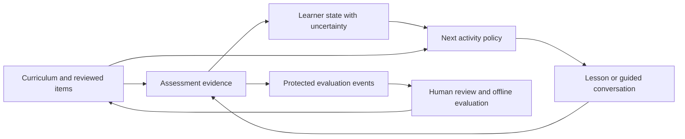

# 03 — Reverse-engineering findings

## REA audit: conditional utility, no installation

**Decision:** REA is an optional evidence-collection tool for authorized local artifacts and browser sessions. It is not the primary instrument for discovering hosted tutoring intelligence. Public technical disclosures deliver more insight for this assignment. This is a bounded source review, not a complete security audit. [R01–R09](11-sources-and-evidence.md)

The inspected `package.json` reports `rea-agents` **6.8.0**, an ES-module CLI/MCP package. Its scripts distinguish compilation, generated catalogs, verification and packaging; dependencies include Babel parsing, Playwright Core, MCP packages and schema validation; Frida is optional. The current main branch is mutable and no commit hash could be retrieved, so this is not a reproducible pinned-release audit. [R02]

| Inspected artifact | Direct finding | Consequence |
|---|---|---|
| `install.sh` | Resolves an exact release, performs global npm installation and may start setup | Do not pipe downloaded installer into a shell; prefer a reviewed pinned local package |
| `scripts/prepare.mjs` | Conditional development dependency patch and Husky hook installation | Installing from source can change repository hooks; inspect transitive scripts too |
| `scripts/rea.mjs` | Routes CLI/MCP modes into compiled runtime; missing runtime fails with build instructions | A source download is not a usable binary distribution |
| `.codex-plugin/mcp.json` and launcher | Version-pinned Node launcher checks package identity/runtime before MCP entry | Integration exists; this does not establish safety of every exposed operation |
| `LICENSE` / third-party notices | REA-authored code MIT; dependencies and external engines retain separate terms | MIT does not grant rights to competitor assets or proprietary decompilers |

These observations come from the linked source artifacts, not execution. [R03–R08]

The browser guide documents CDP page capture, bundle parsing, session observation, screenshots, comparisons and evidence export. Passive capture and action-driving scenarios are separate authorities. Observations are limited by attachment timing and capture completeness. A missing request cannot establish that a feature does not exist. [R09]

The security policy says REA runs with host permissions, is not a sandbox, and can retain sensitive captures. HTTP MCP is an opt-in unauthenticated local service; use stdio or an isolated loopback environment. Target content remains untrusted. Runtime workflows may execute code or interact with devices; static inspection does not authorize those effects. [R07]

### Supported target categories relevant here

Public documentation lists native analysis through external engines, JavaScript/Electron, .NET, Android/JADX and browser inspection. Broad format support does not mean the installed environment supports each path. Local artifacts can reveal client routing or representations; they cannot establish remote mastery equations, hidden tutor policy or model training procedures. [R01]

### Environment result

- Created `work/rea-audit/` as an isolated research area.
- Read installer and selected source through the web tool; did not execute repository instructions.
- Local runtime: `node --version` returned `v20.19.0`. The manifest requires newer supported releases.
- Read-only clone attempt failed: `Could not resolve host: github.com`.
- No installation, global agent configuration, browser debugging endpoint or native provider was created.
- Guessed `src/index.ts` and `src/mcp/main.ts` paths returned 404; they are not represented as inspected application internals. GitHub API commit retrieval was unavailable.

This is an environment limitation, not an automatic approval rejection. No approval escalation was needed because public-source research could continue.

## What this investigation actually established

| Finding | Evidence status | Interpretation |
|---|---|---|
| Public technical disclosures expose useful learning mechanisms | P | Detailed competitor evidence is in 02 and 04 |
| A polished dialogue does not prove persistent mastery tracking | I | Require delayed probes and exported state explanations in any future test |
| Misconception assessment is reproducible without copying item banks | H | Write original distractors linked to an expert-authored misconception taxonomy |
| A local app/client bundle cannot reveal all server decisions | I | Keep backend unknowns explicit |
| No authenticated competitor intervention sequence was observed | D | No original latency, interruption recovery or multi-session behavior measurement |

## Functional architecture inference

This diagram is a generic synthesis, **not a recovered architecture of any named provider**.

## Authorized follow-up protocol

For any later free public demo, record URL, date, public-access terms, curriculum, item identity and each action. Use synthetic student profiles. Run matched sequences: correct answers, identical misconception twice, contradictory performance, hint-assisted success, delayed return, interruption, out-of-curriculum request and code-switching. Repeat because generation is stochastic. Do not enter real children's data into competitor systems.

Record what appears on screen separately from hypotheses about why it appeared. If later REA capture is useful, use a supported runtime in a disposable workspace, pin package/lockfile integrity, review install scripts and provider permissions, use a dedicated browser profile with exact-origin scope and no real credentials, and retain only redacted evidence. Stop at any authentication/payment/access boundary. Avoid interception proxies or certificate changes when passive authorized observation suffices.

## Repository audit team handoff

No product repository was supplied. Audit priorities are therefore questions, not assertions about existing code: trace one assessment event through scoring and mastery; verify tenant isolation in retrieval; enumerate unvalidated LLM writes; verify curriculum version filters; check deletion across logs/embeddings/backups; measure voice turn cost and cancellation; inspect experiment assignment, prompt versioning and rollback. See 10 for acceptance gates.
