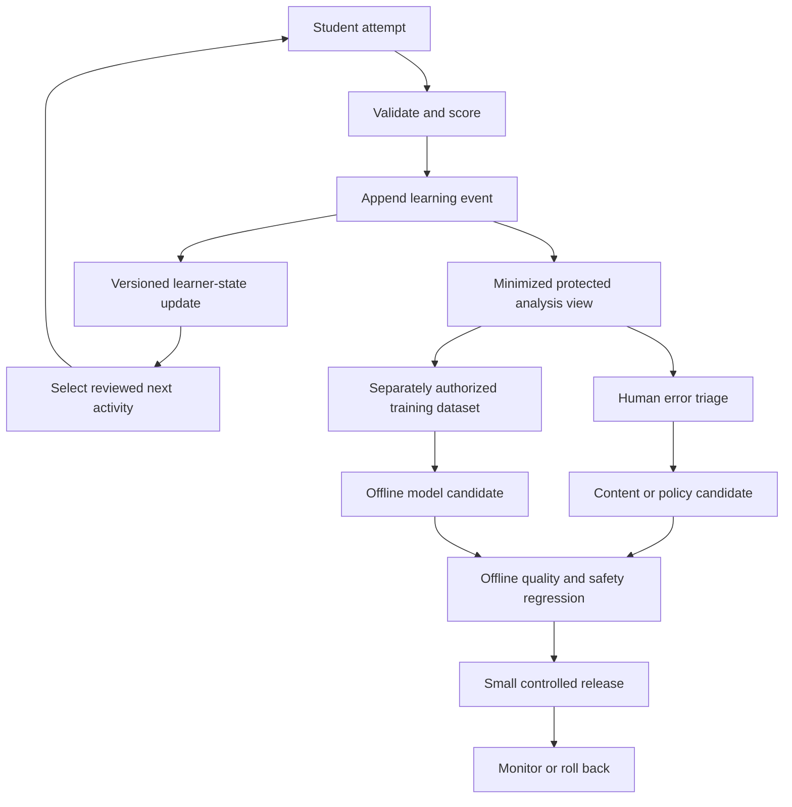

# 05 — Closed-loop intelligence

## Three loops, three release authorities

Everything below is an **H — architecture proposal**, not a claim that competitors operate this exact design. It separates online learner-state changes, reviewed product changes and optional offline model updates.

### 1. Student adaptation: fast, bounded and reversible

Update only the student's evidence-derived state following validated observations. The conversational model proposes interpretations; a deterministic application rule checks and persists them. No LLM may directly overwrite mastery, parental permissions, consent or curriculum identity. Explain the next action using a reason code. Maintain state-version lineage and replayability.

A bad question should be invalidated, then affected state recomputed. A scoring correction must not erase evidence of what happened. A single new student does not modify global teaching policy.

### 2. System improvement: protected aggregation and human release

Collect failure categories: wrong answer key, ambiguous question, invalid OCR, incorrect hint, excessive answer disclosure, unsupported curriculum claim, retrieval failure, speech misunderstanding, inappropriate content, excessive latency and cost. Distinguish user dislike from pedagogical failure. Keep subgroup and exposure counts so one heavy user cannot dominate prioritization.

An educator reviews representative examples, writes an original corrected item or strategy, records rationale and adds regression cases. Ship versioned content/prompts/policies through a release gate. Retain a baseline and immutable release manifest. A kill switch can disable a topic, tool, prompt or voice mode without disabling the whole tutor.

### 3. Model improvement: optional offline work

Do not train continuously on raw chats, thumbs-up ratings or the model's own unverified answers. First establish a stable failure mode that retrieval, tools, content or prompting cannot fix. Require authorized data rights, de-identification review, high-quality educator labels, dataset lineage and a held-out evaluation set. Fine-tuning and preference optimization are candidate methods, not necessary pilot features.

Reject a model upgrade if safety, mathematical correctness, Arabic quality, delayed learning or cost regresses. Keep base-model and adapter identifiers, training-data manifest and reproducible evaluation results. Never imply that state memory is model training.

## Proposed event contract

| Group | Fields and purpose |
|---|---|
| Identity | random event ID, pseudonymous learner ID, tenant ID, session ID, occurred/received timestamps, schema version |
| Curriculum/content | syllabus and academic-year IDs, objective/skill IDs, item family/version, authorized material ID and page references |
| Response validity | response representation or minimized reference, score, grading method/version, ambiguity flag, assistance level, retries, prior exposure |
| Intervention | misconception candidates/evidence, strategy ID, selected action, selection reason, tool outputs and validation results |
| Release lineage | model, prompt, policy, retrieval-index and content versions, experiment assignment |
| Operations | latency stages, input/output usage, audio duration, retry count, estimated and invoiced cost linkage |
| Governance | consent/purpose record, retention class, access scope, correction/deletion lineage |

Store identifying contact data separately. Raw audio and full transcripts are optional sensitive artifacts with short, explicit retention; they are not required fields in every event. Do not insert phone numbers or student names into analytics labels. Separate learning data from commercial message logs.

## Preventing contaminated feedback

- Mark every response as independent, hinted, corrected, repeated or uncertain. Exclude assisted success from evaluation labels that claim independent learning.
- Never use the same student attempt both to generate the answer key and to validate it.
- Human-adjudicate disagreements among model judges; calibrate judges by error type and language.
- Prevent held-out evaluation items from entering prompt examples, training sets or retrieval corpora used during evaluation.
- Detect item duplication and family overlap, not just identical text.
- Quarantine material with questionable rights, prompt injection, personal information or unreliable OCR.
- Track corrections by source and release version, and monitor for shifts in curriculum and user population.

## Suggested release gates

These are acceptance criteria to agree during planning, not empirically established universal thresholds. Every release must pass the curated severe-safety and cross-student-access suite; all changed answer keys and grade mappings require educator approval; unresolved critical mathematical errors block the affected content. Quality scores must be compared to a fixed baseline with uncertainty. Evaluate Arabic, Egyptian code-switching and English separately, including low-confidence audio. Monitor cost and tail latency under realistic turn lengths.

Pilot experiments should change one teaching decision at a time, use safe reviewed alternatives and measure delayed unaided checks. Avoid randomizing children into known inferior or unreviewed instruction. Parent/teacher feedback is useful context but is not a substitute for learning measurement. Small samples support operational learning, not strong causal marketing claims.

## Privacy and safeguarding responsibilities

Use age-appropriate explanations, guardian permissions and verified parent links; school authorization requires a defined institutional relationship. Give children understandable notices and a way to request help. Encrypt records, restrict role access, log sensitive access and test retrieval isolation. Make deletion work across application records, storage, embeddings and downstream processors, with a stated backup expiry policy. Aggregate statistics can remain identifying in small cohorts; suppress small cells and avoid exporting rare combinations.

For launch in Egypt, review Law 151/2020 and current implementing rules with qualified local advice, including children's data, processor contracts, permits and international transfers. The public regulator resource could not be fully read here, so this pack makes no claim that consent alone establishes legal compliance. [T05,T06](11-sources-and-evidence.md)

Maintain a human-owned safeguarding escalation process and published response hours; do not promise a permanently monitored emergency service. Parent progress digests should show evidence and next steps, with minimal sensitive content. Design risks are grounded in child-centered guidance and lifecycle evaluation principles, not just moderation filters. [T03,T04]
