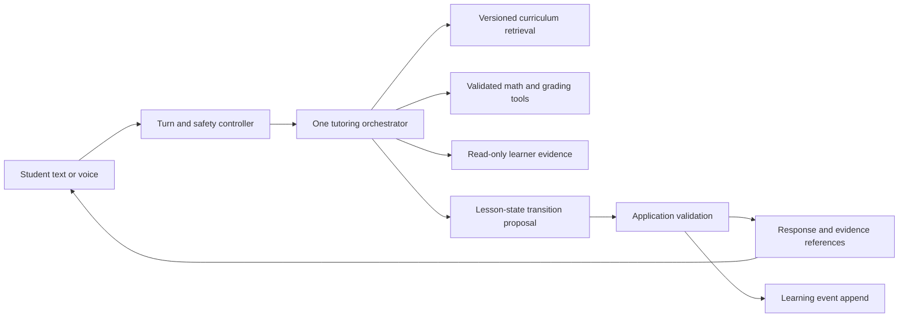

# 06 — Tutor orchestration

## Comparative evidence

Read [02](02-competitor-deep-dives.md) for the full disclosures and [07](07-capability-matrix.md) for unknowns. The most useful contrasts are constrained misconception intervention (Eedi), graph-guided content delivery (CENTURY), tool-backed dialogue (Khanmigo), visual micro-lessons (Synthesis), staged speaking practice (Duolingo), and worked-step error analysis (Squirrel). These are different instructional jobs; “agentic” is not a meaningful quality ranking.

Documented agent/workflow terminology describes components and calls; it does not prove independent autonomous agents improve instruction. A hidden implementation cannot be identified from a Socratic-looking transcript. Nor does calling a model with history establish curriculum grounding or a valid learner model.

## Recommended pilot architecture — H

One application, one relational database, object storage for authorized materials and one background task queue are sufficient starting assumptions. Vector retrieval can be an extension of the same database if needed. A graph database, multi-agent framework and distributed event bus need demonstrated requirements before adoption.

### Instructional state machine

Suggested states: orient → elicit attempt → inspect reasoning → offer minimal hint → request next step → check independently → reflect → schedule review. Allow short direct explanations and worked examples when the learner lacks prerequisites; endless questioning is not a pedagogy requirement. Permit the child to ask for clarification, switch input mode or pause. A conversation can leave and re-enter an activity without losing the question, last accepted step, hint level or pending assessment.

Keep the student-facing style warm and specific. Avoid claiming emotion detection, inventing familiarity, inducing guilt about streaks or making the child dependent on the tutor. Let students select preferred explanation language, while keeping official terminology and symbols visible.

### Tool contracts and hallucination control

Tools should have narrow schemas for curriculum lookup, original item selection, answer checking, unit conversion, diagram retrieval and evidence recording. Reject unknown skill IDs, stale item versions and malformed outputs. A model-selected tool call is a proposal; authorization, tenant scope and validation belong to the application.

Store reviewed solutions and acceptable variants. Symbolic/numeric checks help with well-defined tasks but need domain constraints: algebraic equivalence can fail at excluded values, units matter, and an equivalent final answer does not validate the student's reasoning. Generated questions require independent solution verification before student use. Unverifiable questions are drafts for educator review.

If confidence is inadequate, request a clearer image or an additional step; if the textbook conflicts with a computed result, show the disagreement for human review. The tutor should say it cannot verify an answer rather than fabricate a confident explanation. Models checking one another can share mistakes and do not remove the need for curated references.

### Memory: separate stores with explicit purposes

| Memory | Contents | Update authority |
|---|---|---|
| Session working state | current problem, accepted steps, interruption checkpoint | validated orchestrator transitions |
| Learning evidence | dated independent/assisted attempts, uncertainty, review schedule | scoring/state rules |
| Preferences | chosen language, accessibility settings, optional familiar examples | learner/guardian with bounded extraction |
| Content retrieval | authorized pages and reviewed mappings | content ingestion review |
| Safety record | minimal incident information and escalation status | restricted safeguarding workflow |

Avoid putting the entire transcript into every prompt. Retrieve only relevant, purpose-appropriate records; summaries can be wrong, so preserve provenance and correction paths. Personal facts are not knowledge evidence. Do not infer long-term deficits from one difficult session.

### Uploaded-material grounding

Proposed ingestion: authorization declaration → file validation → OCR/layout extraction → human spot checks → curriculum/edition labeling → page-aware chunking → retrieval evaluation. Preserve equations, tables, diagrams and Arabic reading order. A page image may be needed when text extraction loses notation.

Filter by learner/tenant, curriculum, subject, year and edition before semantic ranking. Cite the actual retrieved page; a source citation is not proof the explanation is correct. Treat all uploaded text as untrusted instructional content, never tool instructions. Do not expose one student's material to another or add private uploads to shared training by default. Public availability does not grant textbook redistribution rights. [T07](11-sources-and-evidence.md)

## Voice architecture options — H

| Option | Benefits | Limits | Pilot choice |
|---|---|---|---|
| Push-to-talk ASR → tutor text → TTS | inspectable transcript, controlled turns, provider substitution | added stages and audible gaps | baseline for measured comparison |
| Streaming ASR plus incremental TTS | earlier response, flexible components | partial transcripts can misgrade; cancellation complexity | after stable baseline |
| Native speech-to-speech | expressive, potentially smoother interaction | opaque scoring evidence, provider coupling, cost variability | benchmark before commitment |

No primary competitor in this review supplies enough comparable measured data to rank Egyptian child voice performance. Arabic support labels are insufficient. Recent Arabic speech work provides evaluation leads, including child and code-switching contexts, but cannot substitute for the pilot's spontaneous classroom speech. [T08–T10]

Measure microphone-end → final transcript → first model token → first audible response, plus full-turn p50/p95, interruption stop time and failure rate. These are measurement definitions, not promised latency. Cancel obsolete generation/audio when a new turn starts; ensure late results cannot update the wrong activity. Verify mathematical names, negatives, decimal points, fractions and English technical terms explicitly. Ambiguous transcription must trigger confirmation rather than reduce mastery.

## Sustainable cost design

Per session cost = text input/output + ASR minutes + TTS output + speech transport if billed + retries + tool/OCR/storage allocation + messaging + human review. Count cached and uncached input separately. Track lesson success and learning gain per cost, not only tokens per reply.

Illustrative planning arithmetic, **not provider pricing**: at a founder-selected variable-cost ceiling of $0.20 per 20-minute session and eight sessions/month, the allowance is $1.60 per student/month before support, payment fees, acquisition, taxes and fixed costs. Test an audio-heavy upper-use scenario as well as median use. Whether that ceiling is attainable remains unmeasured.

Precompute reviewed explanations, cache only nonpersonal material under content/version keys, use short turns and bounded context, grade deterministically where valid, and route difficult cases to a stronger model only when measured quality justifies it. Compare paid speech with self-hosted options on total maintenance and compute cost; open weights do not imply free operation. Avoid unlimited voice promises until real usage distributions and invoiced costs are known.

WhatsApp pricing access was blocked by a login page in this research. No current Egypt message rate is asserted. Parent-message unit economics and allowed template categories must be verified from current official documentation during planning. [T11]
