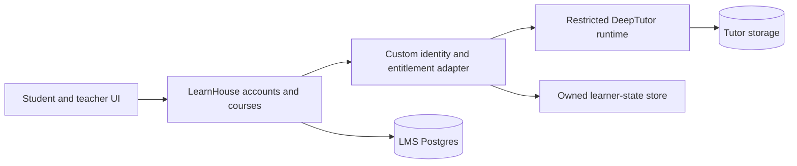
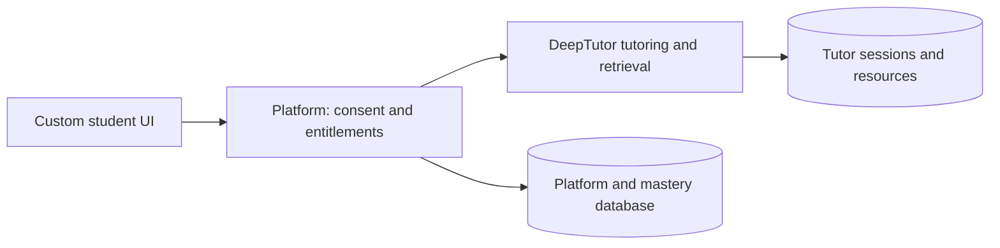
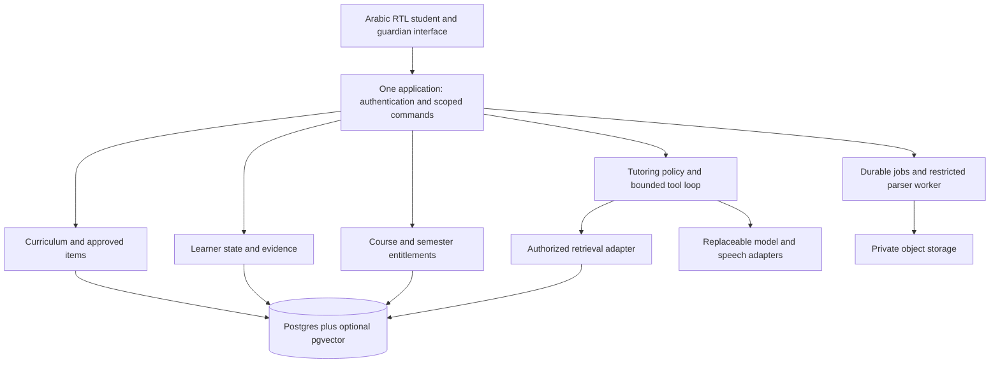
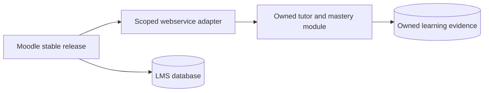

# Architecture alternatives and recommendation

10 November 2026. Decision: prefer **C, narrowed to an owned modular monolith with selective permissive reuse**. Use DeepTutor as a reference first and extract only modules that pass a dependency/isolation experiment. Do not copy LearnHouse AGPL code into a proprietary core. Option C therefore uses lessons from both repositories but does not force source extraction from both. Option A is not the default merely because both products are open source.

## A — LearnHouse core + DeepTutor engine

Coverage is broad for course administration and tutoring workflows, yet no common curriculum/mastery/guardian schema exists. The bridge must map user/org/course/workspace IDs, enforce enrollment before each tutor request and document read, stream/cancel turns, reconcile usage and translate assessment events. Duplicate RAG, UI, auth, upload and analytics systems increase failure modes. Keep stores independent; no direct table joins across upstream products.

AGPL obligations for LearnHouse modifications and potential combined-work boundaries need review; service separation is not a legal conclusion. Enterprise payment and analytics rights cannot be assumed. Protecting minors would require testing both authorization layers and every bypass route. Upgrade risk is high because both evolve quickly. Operating footprint includes two backends, frontend(s), tutor storage/jobs and LMS database/cache. Exit requires exports of content/assets and memberships, plus separately owned learner events. Estimated integration experiment: 3–5 engineer-weeks; safe narrow pilot: 20–32 engineer-weeks. These are planning ranges, not quotes or runtime measurements. Reject for initial solo-founder pilot.

## B — DeepTutor foundation + lightweight custom course platform

Strongest reuse is tutoring, retrieval, memory, questions and mastery-path workflows. Recent source contains considerably more than an agent demo; it must not be described as lacking all memory or mastery. However, personal-workspace behavior and generative learning state are not automatically a commercial multi-tenant curriculum platform or a validated mastery estimator.

Custom work includes course/semester catalog, ownership, payment ledger, guardian verification, consent, retention, item bank, controlled policy and end-to-end isolation. Restrict exposed APIs; do not make an entitlement-gated UI in front of a reachable unrestricted backend. Disable general execution, partner/MCP/plugin management and arbitrary external fetches for student requests unless separately justified. Apache-2.0 is comparatively straightforward, but optional dependencies remain separate.

Upgrade risk is medium-high because behavior and storage evolve; extensive fork changes weaken upstream compatibility. Low early UI effort can become high hardening effort. Operating cost adds tutor data/index/process management and agent/tool-call amplification. Exit depends on exporting typed events and owning curriculum IDs rather than relying on opaque session memory. Experiment 2–4 weeks; safe pilot 14–22 engineer-weeks. Fallback if isolated tutor-service tests prove materially cheaper than selective extraction.

## C — Owned modular monolith + selected components

Build a small platform with Django auth/admin/ORM and a web UI; use Postgres for events, state, content metadata, entitlements and initial jobs. Keep document parsing in a restricted process with a separately locked environment; this is a security/runtime boundary, not a distributed business-service architecture. Optional audio worker comes later.

Feature coverage initially narrower: one system, year, subject and semester; text-first with capped voice. This is a deliberate product scope that tests the core learning loop. Reuse permissible libraries and selected DeepTutor designs/modules only after extraction tests. LearnHouse contributes design lessons unless the founder accepts AGPL or obtains sufficient commercial rights; do not hide copied code inside a proprietary package.

Lowest long-term operational and licensing complexity among choices, but platform workflows and curriculum QA must be built. Django does not supply object-level isolation or guardian verification automatically. Centralize permissions and deny raw database access to model tools. Upgrade by package adapters and migrations rather than long-lived forks. Exit: standard SQL exports, private assets manifest, versioned events and provider-neutral contracts. Experiment 10–15 engineer-days; narrow supervised pilot 10–16 engineer-weeks after experiment, with separate curriculum, legal and educator work. Recommend.

## D — Alternative LMS + custom tutoring

Moodle is the stronger alternative when teacher assignments, gradebook and institution workflows are first-order requirements. Source-reviewed quiz webservice capabilities provide a credible boundary. Parent roles exist as configurable roles, not verified consent. Do not deploy the audited default branch: it is 6.0dev/alpha. Select a maintained stable release and review plugins, PHP requirements and update procedures first.

GPLv3+ differs from AGPL: network interaction alone does not add AGPL section-13 duties, but distribution and combined plugin obligations still matter. A separately authored tutor is not automatically exempt from all copyleft questions. Moodle hosting, upgrades, themes, plugins, translations and workflow fit add work. Frappe LMS is a second inspected alternative, but its AGPL license and framework/Python requirements make it less attractive as a proprietary shortcut.

Coverage high for LMS features, low for adaptive conversational learning; integration difficulty medium-high; solo maintainability medium-low; operating footprint two systems. Exit via content/grade exports plus owned tutor events. Experiment 3–4 weeks; safe adapted pilot 16–26 engineer-weeks. **Strategic fallback** if competitive research or pilot interviews show teacher-led courses are the main buyer need.

## Comparative decision table

Scores are ordinal judgments (5 favorable), not measurements.

| Option | Initial breadth | Solo upkeep | License simplicity for proprietary core | Security surface simplicity | Extensibility | Main cost driver |
|---|---:|---:|---:|---:|---:|---|
| A both full systems | 5 | 1 | 1 | 1 | 3 | Duplicate runtimes and bridging |
| B full DeepTutor + custom | 4 | 2 | 4 | 2 | 3 | Runtime hardening and fork upgrades |
| C custom + selective reuse | 3 | 4 | 5 | 4 | 5 | Initial platform and curriculum work |
| D alternative LMS + custom tutor | 4 | 2 | 3 | 2 | 4 | LMS operations plus tutor integration |

Initial effort includes authentication, basic authorization and testing, not a guarantee of regulatory readiness. Add educator review, paid assessment content, support operations and counsel as separate budgets. A full multi-system commercial platform is likely a multi-quarter solo project; AI coding tools do not eliminate security, curriculum or outcome validation.

## Conditions that change the decision

Choose D if institutions demand gradebook/assignment/course import immediately and will tolerate an LMS-centered experience. Reconsider B only if its pinned API passes authorization, state export, cost and restricted-tool tests with little fork code. Consider LearnHouse alone with custom intelligence if AGPL/enterprise terms fit the business and native AI passes quality tests. A failed DeepTutor extraction should remove that dependency, not force a larger integration.

Maintain one canonical user/guardian graph, one entitlement ledger and one assessment event stream in all options. Never synchronize mutable mastery in two stores. Start with versioned curriculum and immutable evidence so a later LMS or model replacement does not reset student progress.
