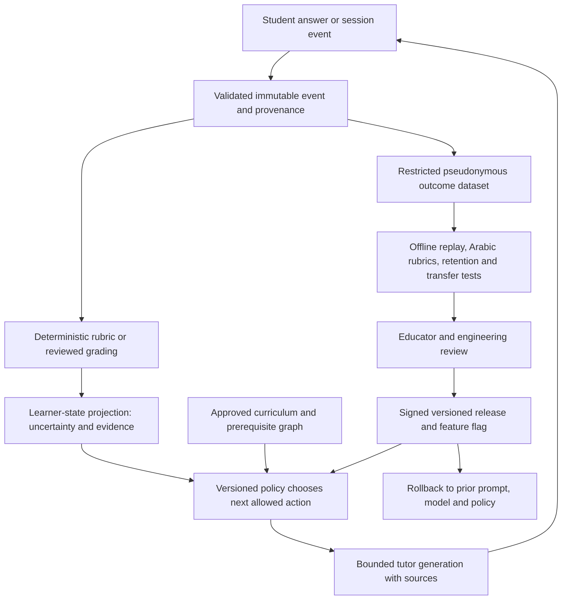

# Recommended technical foundation

10 November 2026. Recommend **an owned modular monolith, with neither DeepTutor nor LearnHouse adopted wholesale**. DeepTutor is the stronger source of permissively licensed tutoring patterns and small candidate modules; LearnHouse is a useful LMS reference/fallback, subject to AGPL and enterprise decisions. Do not require both to justify the research.

## Proposed stack

| Layer | Initial choice | Why / fallback |
|---|---|---|
| Product backend | Django 5.2 LTS at a current patched release; Python 3.12 | Auth, admin, ORM, migrations, CSRF and i18n reduce solo-founder platform work; 5.2 extended support through April 2028 per [official table](https://www.djangoproject.com/download/#supported-versions). Framework is a proposal, not source-audited here. FastAPI is fallback if a validated DeepTutor extraction makes Django integration materially harder. |
| Student UI | Small accessible RTL-capable interface; Django templates plus a focused browser chat/audio component | Avoid a separate full frontend framework unless interactive requirements justify it. Rich React UI can be added behind the same contracts; no need to inherit either full upstream frontend. |
| Source of truth | Supported managed PostgreSQL 17/18, private object storage | One transactional store for curriculum metadata, events, state, jobs and entitlements; region/provider subject to legal transfer review. |
| Retrieval | Lexical baseline, pgvector if useful, one multilingual embedding adapter | Keep chunks/metadata and provenance owned; no mandatory graph/vector service. |
| Parsing | Docling worker with a separately locked environment and strict resource limits | Worker has quarantine assets only, no broad credentials; PaddleOCR fallback after target-page benchmark. |
| Tutoring | Custom bounded state/action loop with one model adapter, structured tools and citations | DeepTutor interfaces and source can inform implementation; extraction is optional after dependency proof. |
| Learner state | Owned evidence ledger and rule-based projection | Explicit unknown and uncertainty; optional fixed/pooled BKT later; never derive final mastery from chat sentiment. |
| Revision | py-fsrs or a simpler initial due-date rule | Separate recall schedule from concept mastery; review-log export and algorithm versions. |
| Math | Teacher-validated answer keys; bounded restricted SymPy worker when needed | No raw `parse_expr` on untrusted text; units/domain constraints recorded. |
| Audio | Text-first pilot; optional capped push-to-talk through replaceable speech adapter | Full duplex/Live/Pipecat only after Egyptian math fidelity, latency, privacy and unit economics pass. |
| Entitlements | Owned course/semester grants and request reservations | Gateway collection separate from access; manual prepaid grants before merchant approval acceptable. |
| Jobs | Postgres job leases/outbox and same application worker | No Celery/broker initially; add after measured need. |
| Evaluation/ops | Versioned fixtures and Promptfoo offline; structured logs and OTel | Redaction first; defer full Langfuse infrastructure. |

Repository sources and exact audited commits are in [01](01-repository-inventory.md), candidate implementation references in [05](05-additional-open-source-components.md). Proposed framework/database patches, model IDs and provider account access must be rechecked when implementation starts. No deployment lockfile was resolved or product built.

## Domain modules and authority

Keep modules for identity/consent, curriculum, assessments, learner state, tutoring policy, entitlements, notifications and evaluation/operations in one codebase. Business modules call each other through typed application services, not arbitrary SQL from model tools. Only worker/runtime boundaries justified by file parsing or audio dependencies need separate processes. Do not start with microservices, Kafka, a graph database or a model-training cluster.

| Domain | Owns | Must not own |
|---|---|---|
| Identity/consent | Auth identity, guardian edges, permissions, consent evidence and revocation | Model inferred preferences or mastery labels |
| Curriculum | Education system, grade, subject, academic year, edition, concept graph, source/rights record, reviewed lessons/items | Student private uploads automatically published as authoritative curriculum |
| Assessments | Item/rubric versions, attempt evidence, grading confidence, hint exposure, teacher adjudication | An untraceable mutable score with no original evidence |
| Learner state | Rebuildable concept projection and misconception hypotheses | Authentication, payments, or autonomous diagnostic claims |
| Tutoring policy | Next action under prerequisites, evidence, safety and budget | Direct permission/entitlement writes, curriculum publishing or self-deployment |
| Commerce | Grants, expiry, invoices/payment references, limits and usage reservations | Card data or implied consent from payment alone |
| Evaluation | Versioned tests, release decisions, outcome analysis and rollback | Automatic training on identifiable chat or live code/prompt mutation |

Use an internal `student_id` distinct from login actor: a guardian can pay and view permitted summaries without acting as the learner. Course access requires enrollment **and** active entitlement **and** valid consent/relationship rules where applicable. A single-organization pilot still needs student isolation. Future tenant IDs belong in domain records now without building multi-institution administration.

## Conceptual data model

- `EducationSystem → Grade → Subject → CurriculumEdition(academic_year, semester, immutable_version)`.
- `Concept` and versioned prerequisite edges; concept revisions mapped explicitly between editions.
- `SourceDocumentVersion` and `Chunk(page, block, rights, owner, visibility, approved)`; uploads start private/quarantined.
- `ItemVersion`, concept/Q-matrix mapping, difficulty tier, answer/rubric, source and reviewed publication status.
- `AttemptEvent(event_id, learner, item_version, score, independent_or_hinted, grader_version, confidence, timestamps)`.
- `KnowledgeProjection(student, concept_version, status, evidence_count, uncertainty, last_independent_success, projection_version, event_cursor)`.
- `MisconceptionHypothesis(evidence_ids, category_version, confidence, reviewer_status, expires_at)`; no permanent deficit label.
- `ReviewCard`/review log independent from mastery; `TutorSession`, policy/prompt/model versions and bounded summaries.
- `GuardianEdge`, `ConsentRecord`, `Enrollment`, `Entitlement`, `UsageReservation/Receipt`, `Job/Outbox`, `AuditEvent`.

State transitions are transactional/idempotent and rebuildable. A lesson completion, LLM praise or self-reported confidence is not equivalent to an independently correct answer. Store preferences as volunteered/current information, not fixed learning-style diagnoses; student confidence is distinct from estimator confidence.

## Closed-loop architecture

### Learner state

Collect assessment/session events with a known meaning, evidence source and timestamps. Update state only after grading; untrusted model output must validate against a schema and confidence rules. Mark unknown rather than zero mastery for no evidence. Separate unassisted, hinted, repeated-item and tutor-demonstrated answers. Stale/out-of-order events trigger a defined projection replay; duplicates have no additional effect. Each hypothesis links to evidence and has an expiry/review path.

DeepTutor supplies memory/mastery structures and cheap heuristics worth studying; pyBKT supplies an optional fitting/comparison tool; FSRS handles recall scheduling. LearnHouse supplies activity completion but no verified durable psychometric state in inspected source. The canonical schema, grading semantics and curriculum linkage must be built.

### Tutoring policy

Choose among diagnostic question, explanation, worked example, independent practice, prerequisite remediation and spaced revision. Use a few transparent rules before learning a policy. The action is selected by deterministic application logic over state, approved prerequisites, safety and entitlement; the LLM phrases and explains within that action and may request allowed information. A generative plan cannot silently rewrite the curriculum graph, final score or subscriptions. Retain teacher override and student correction/appeal.

DeepTutor's mastery loop and LearnHouse's native AI can generate/adapt content but do not establish a calibrated safe policy for Egyptian children. No research-library RL agent is approved for exploratory action selection in the pilot.

### Evaluation and controlled improvement

Attach feedback to exact `request_id`, answer, item, retrieved source, model/prompt/policy and rubric version. Distinguish factual-error reports, unclear explanation, grading disagreement, unsafe content and user preference; a thumbs-up is not a mastery update. Have educators adjudicate safety/grade issues, and correct affected projections by replay from original evidence.

Maintain a versioned offline set with Arabic/MSA/English slices, source-grounding labels, expected abstention, mathematical equivalence and injection cases. Keep a frozen holdout separate from prompt tuning. Track Brier/calibration/log loss for estimators, rubric agreement for grading, source support and safety for tutoring, plus independent pre/post and delayed retention/transfer outcomes. Split by learner/time/item family to avoid leakage; do not claim causal learning gains from engagement or prediction AUC.

Experiments require a named hypothesis, educator-approved safe variants, assignment unit, primary outcome, stopping rule and rollback owner. For a tiny pilot use shadow evaluation and paired qualitative review; do not claim significance from 20 children. Later use learner/course-level assignment to avoid contaminating a child's policy midstream, common anchor tests, baseline adjustment and confidence intervals. Avoid repeatedly peeking at a holdout or selecting variants solely on session duration.

Release manifests specify code SHA, prompt content hash, model snapshot, retrieval/embedding version, curriculum edition, rubric and estimator version. A regression or safety failure blocks promotion. Start in shadow, then a small feature-flagged cohort only after human approval. Keep prior manifest and reversible data migrations; rollback stops new-policy use without erasing learning evidence. Replay state only through reviewed migration rules. No self-modifying code, automatic online training or silent prompt replacement.

An identifiable conversation is not a training dataset. Deidentification, minimization, consent/legal basis, rights, sampling review and re-identification risk need separate approval before any research corpus. Preserve opt-out/deletion scope in derived datasets. Store audit decisions without publishing child records.

## Operations and exit strategy

Run application, database and a restricted parser worker with managed TLS, secrets, private assets and backups; start with infrastructure small enough to understand. Add separate media workers only when audio demand justifies it. CI performs unit/authorization/contract tests, Arabic regression evaluation with mocked providers, migration checks, dependency/license checks and a staging restore drill. Paid evaluation jobs require budget approval; no paid run occurred here.

Exports include source/assets manifest, curriculum/item versions, attempt events, review logs, consent/grants and rebuildable state. Provider adapters normalize streaming, usage, cancellation, error classes and retries. Preserve original chunks so embedding providers can be replaced through dual indexing; preserve prompts/evaluation sets so model changes can be compared. Exporting opaque model summaries alone is not an adequate migration path.

Review copied Apache modules through a small internal package with origin SHA, license/NOTICE and adaptation notes; avoid a broad fork. LearnHouse code is not part of the proprietary baseline. If its LMS workflows become essential, resolve AGPL/EE terms and integrate through scoped contracts after legal review. **Strategic fallback:** a stable Moodle release plus an independent tutoring/state module when teacher-led LMS functionality is the buyer priority. **Technical fallback:** remove failed DeepTutor extraction and retain the bounded owned loop.

## Phased delivery and decision dependencies

1. Research-to-build gate: approve a single curriculum/age group, content rights, legal data flows, metrics and engineering budget.
2. Experiment in [11](11-integration-proof-of-concept-plan.md): 10–15 engineer-days, no product breadth expansion.
3. Narrow supervised pilot: estimated 10–16 engineer-weeks after experiment, plus educator/curriculum/legal/support work. Progressively deliver consent/accounts/grants, approved text tutor, independent practice/state, guardian summary and operations.
4. Commercial hardening: payment gateway/refund automation, load and security review, localization/accessibility, retention/incident operations and capped voice after measured demand. Broad multi-system curriculum and teacher authoring are later scopes.

The separate global competitive research must decide initial segment, curriculum/grade/subject, exam urgency, parent versus teacher buyer, voice necessity, differentiation beyond generic chat, willingness to pay, content rights/distribution, teacher workflow expectations and feasible acquisition/support costs. Those findings can change pilot scope or favor an LMS; they do not justify delaying the source-backed choice to avoid a forced two-product integration. No competitor findings were supplied, so none are invented.
